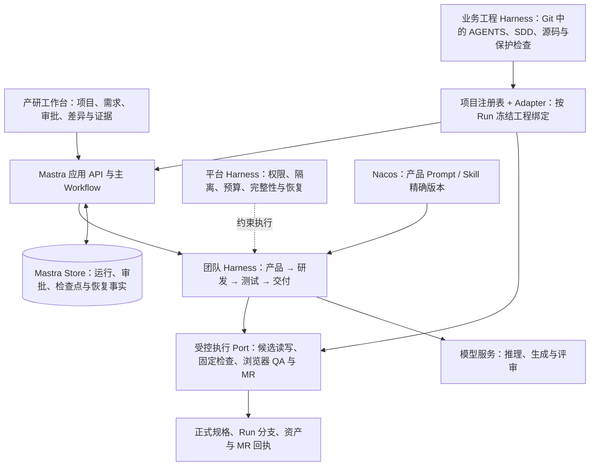
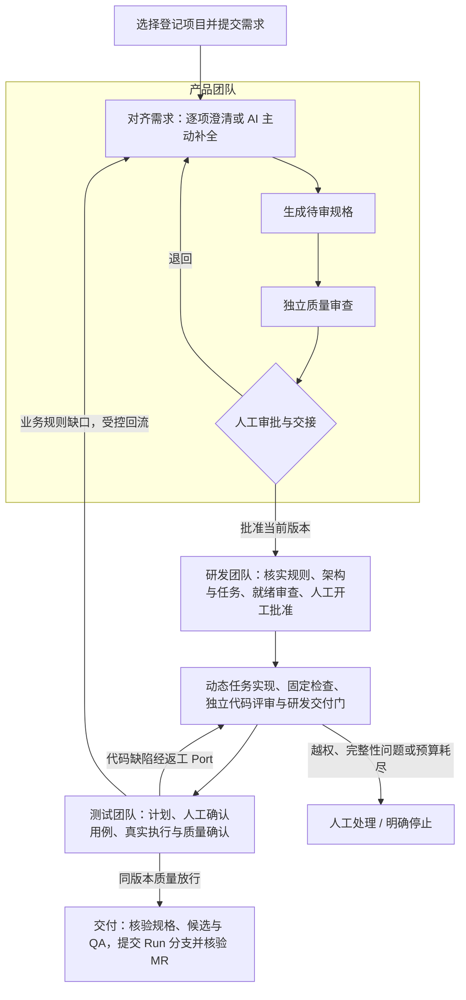

# AI 应用基础平台 v2.0

以 **Mastra Workflow 为流程控制核心、Agent 为专业执行单元、Git 规格与保护检查为工程契约、Mastra Store 为运行事实源**的 AI 产研平台。将需求、方案、实现、独立测试和人工确认串成可追溯、可恢复的执行链；默认终点为提交并核验指向 `main` 的 MR，不默认自动合并或部署。

根目录是 Mastra 主线。原自研 Runtime、Demo、LiteLLM 和 pi 实验位于 `practices/custom-exploration/`，依赖、配置和数据独立，不能自动计入主线能力。

## 整体架构

当前形态是模块化单体应用与独立工作台，不是每个 Agent 一个微服务。平台仓库负责执行与治理，被接入的业务 Git 仓库负责自己的规则、SDD、源码和保护检查。



三层职责分别是平台执行治理、团队专业闭环、业务工程契约；跨团队调用由主 Workflow 负责。Agent 组合角色职责、版本化方法、任务上下文、模型和最小工具；检查、权限与交付门由确定性代码判断，人工决定不能由模型代替。

Mastra Store 是唯一运行事实源；Git 交接、资产目录、档案和页面是规格、产物或只读投影，不构成第二套审批或恢复引擎。详细角色、数据归属与证据链见 [Harness 架构](docs/application/harness-architecture.md)。

## 产研工作流

日常使用[产研工作台](http://127.0.0.1:4112/)。整个流程在同一个 `productDevelopmentWorkflow` 根 Run 下，通过原生子 Workflow、暂停和恢复推进。



图是业务语义概览，回流必须通过版本、证据和预算校验，不表示任意跳转。研发自检不等于独立测试，MR 不等于已合并或上线。详细关口与历史兼容见[完整产研流程](docs/application/unified-workflow.md)，动态组队与候选屏障见[研发内部执行图](docs/application/development-workflow-design.md#当前研发内部执行图)。

## 当前能力与边界

| 领域 | 已接入主线 | 尚不能据此承诺 |
| --- | --- | --- |
| 专业协作 | 产品经理与独立审查、研发负责人/动态实现/独立评审、独立测试和 MR 交付 | 无人参与的全自动软件工厂 |
| 受控自治 | 批准路径、受限委派、真实固定检查、有界返工与失败恢复 | 任意 shell、自由扩权或无限自修复 |
| 公共 Team Loop | 研发与测试接入公共信封、纯决策和返工 Port | 所有团队已经统一执行内核或完全解耦 |
| 多项目 | Run 级绑定贯穿产品上下文、候选、资产、归档、同步、后继与 MR | 完整多租户授权、跨进程创建幂等或生产多实例验收 |
| 工程适配 | 登记 Node/Python 固定 Adapter；HRM 保留兼容 Docker 执行档 | 任意技术栈自动接入、完整环境跨机器复现 |
| 方法与上下文 | 产品 Nacos 精确版本快照、研发本地方法锁、固定版本按需读取与调用级 Memory | 全团队已迁入 Nacos、共享跨项目长期记忆 |
| 浏览器 QA | 批准候选静态 HTML 与资源的真实 Chromium 回执 | 任意动态全栈应用自动启动与业务验收 |
| 交付与验证 | 同版本证据核验、Run 分支及 MR 回执机制 | 默认自动合并、CI/CD、部署；fixture 代替真实业务质量 |

以上区分“机制已实现”和“真实业务/生产验收”。具体历史结果以关联 ADR 和评测记录为准，不以测试数量代替能力结论。

## 快速启动

使用 Node.js 24+。在克隆的仓库根目录执行：

```bash
npm ci --ignore-scripts --no-audit --no-fund
npm --prefix web ci --ignore-scripts --no-audit --no-fund
```

后端与前端分别保持一个终端；同一项目目录只启动一个 Mastra dev 实例。

```bash
# 终端一：固定响应模式，关闭 Nacos，不调用真实模型。
NACOS_RESOURCES_ENABLED=false MASTRA_MODE=fixture MASTRA_DATA_DIR=.data/fixture npm run dev

# 终端二：工作台，代理到 127.0.0.1:4111。
npm run review:dev
```

打开工作台，填写需求与迭代标识；注册表模式还需显式选择项目。fixture 不理解业务输入，只验证固定控制流；检查仍可能依赖对应 Adapter 的运行环境。查看和恢复 Run 需保持原模式、数据目录与受校验的工程/执行身份。

- [工作台](http://127.0.0.1:4112/)：需求、人工关口和证据。
- [Studio 流程图](http://127.0.0.1:4111/workflows/productDevelopmentWorkflow/graph)：技术调试。
- [产物查看页](http://127.0.0.1:4111/delivery-assets)：只读资产与历史版本。

## 配置入口

配置说明和示例见 [.env.example](.env.example) 与[运行配置指南](config/README.md#运行配置指南)。真实凭据只放本机根 `.env` 或进程环境，不能提交；进程环境优先，工作台不持有模型密钥。

| 配置 | 用途 |
| --- | --- |
| `MASTRA_MODE` / `MASTRA_DATA_DIR` | 区分 fixture/live 与数据目录；live 会产生模型费用 |
| `MASTRA_MODEL` / `MASTRA_BASE_URL` / `OPENAI_API_KEY` | 默认模型与服务出口；live 需显式配置 |
| `MASTRA_PRODUCT_MODEL` / `MASTRA_DEVELOPMENT_MODEL` | 产品与研发角色覆盖；未设置时回退默认模型 |
| `NACOS_*` | 默认启用的产品 Prompt / Skill 精确版本与只读访问；未配置时需显式关闭 |
| `MASTRA_ENGINEERING_PROJECTS` | 多项目注册表；客户端仅提交 ID，初始化冻结 Run 绑定 |
| `MASTRA_ENGINEERING_PROJECT` | 历史单项目入口，与多项目配置互斥 |
| `MASTRA_HRM_REPOSITORY` | 未登记项目时的 HRM 兼容 checkout，默认同级 `hrm` |
| `MASTRA_REMOTE_SYNC_TARGETS` | 历史远端同步目标初始字典；登记项目按自身 Run 绑定路由 |

登记项目需在固定 commit 中提供三份 SDD 和 `specs/engineering.json`，不能只填写仓库地址就自动开放实现；无工程骨架时可先只读规划，准备缺口未解除不得实施。[项目登记与 manifest](docs/application/harness-architecture.md#登记业务工程项目)解释文件规则、Adapter 和恢复约束。

真实模式先按配置指南准备模型、Nacos 和明确授权的工程/同步环境，再执行 live 冒烟或启动。live 冒烟会调用真实模型；阶段同步和 MR 可能写远端，不能把 fixture 的无远端写入边界套到 live。服务当前仅供本机使用；本机账号及人工关口见[工作台说明](docs/application/guided-intake.md)。

## 开发与验证

```bash
npm run check
npm run review:build
npm test
npm run smoke
npm run build
```

默认启用 Nacos；未配置资源的构建环境可显式使用 `NACOS_RESOURCES_ENABLED=false npm run build`，仅作用于该进程。部分工程回归需要 Python 或 Docker，按对应案例准备。命令列表不表示本次文档整理重跑了所有检查。

固定控制流、真实工程执行、真实模型质量与生产验收分别记录。评测见 [evaluations/](evaluations/README.md)；模型调用、费用、远端写入和生产操作需明确处理。贡献规则见 [AGENTS.md](AGENTS.md)，行为变化先更新 OpenSpec，决策依据进入 ADR。

HRM 兼容基线可用 `npm run verify:hrm -- /path/to/hrm` 单独检查，需要 Docker；结果是登记工程检查证据，不等于业务验收或部署授权。

## 代码目录

```text
web/                         工作台
src/mastra/                  应用装配、Agent、主编排与平台机制
src/intake/                  需求、澄清、纠偏、恢复与时间线
src/team/                    公共团队信封与纯 Loop 决策
src/development/v2/          研发角色、任务、动态团队、预算与门禁
src/business-engineering/    项目注册、SDD、规则与 Adapter
src/browser-qa/              批准候选的浏览器验证
src/delivery/                独立测试、资产、归档、同步与 MR
src/evaluation/              原生评分器与节点评测
.agents/skills/development/  本地版本化研发方法
nacos-resources/product/     产品方法资源与清单
openspec/                    稳定行为契约与变更
docs/decisions/              架构决策
tests/ evaluations/ scripts/ 回归、评测与维护
practices/custom-exploration/ 独立探索实践
```

## 专题文档导航

| 需要了解 | 阅读入口 |
| --- | --- |
| 三层职责、Agent 组合、事实所有权、AI 工程化证据链 | [Harness 架构](docs/application/harness-architecture.md) |
| 产品、研发、测试、交付和人工关口 | [完整产研流程](docs/application/unified-workflow.md)、[工作台](docs/application/guided-intake.md) |
| 动态组队、依赖并发、检查与研发交付门 | [研发执行设计](docs/application/development-workflow-design.md#当前研发内部执行图) |
| 公共 Team Loop、Node/Python、Run 级多项目路由 | [Team Loop 与项目 Adapter](docs/application/team-loop-architecture.md) |
| Git 交接、Nacos 冻结与按需上下文 | [流程与资源流](docs/application/visual-framework.md) |
| 资产下载、Run 档案、远端同步与恢复边界 | [产物归档与数据流](docs/application/artifact-dataflow.md) |
| 模型、Nacos、上下文及配置权威入口 | [配置指南](config/README.md)、[角色资源清单](docs/application/agent-resource-inventory.md) |
| 浏览器安装、批准用例及回执限制 | [浏览器 QA](docs/application/browser-qa.md) |
| 需求契约与决策依据 | [稳定规格](openspec/specs/project-mainline/spec.md)、[ADR 索引](docs/decisions/README.md) |
| 实验和评测结论 | [评测入口](evaluations/README.md)、[招聘管理验证项目](projects/pm-hrm-recruitment/README.md) |

README 提供入口，架构文档解释机制，AGENTS 约束协作，OpenSpec 定义行为契约，ADR 记录决策。配置盘点 JSON 是审计快照，不是可直接修改权限或审批的运行时配置；边界见[资源接入定义](config/runtime-resource-contract.md)。
