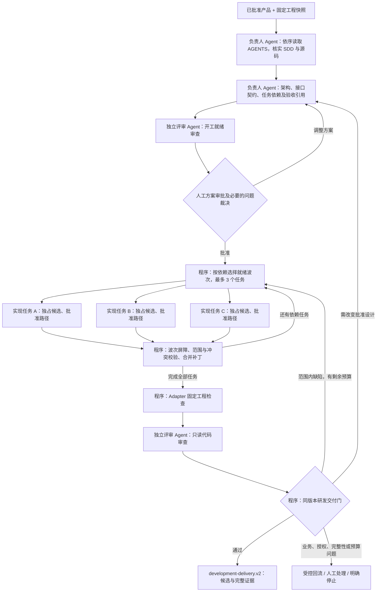

# 研发阶段工作流设计

> 文档范围：当前研发内部执行图及早期开发模块设计基线，包含历史 CLI 用法。当前操作使用[产研工作台](./guided-intake.md)，当前主链与返工边界见[完整产研流程](./unified-workflow.md)。历史范围、重试政策及计数不表示当前主线能力或测试总数。

## 当前研发内部执行图

当前主线由 Mastra 嵌套 Workflow 执行，默认交付经独立测试后进入 MR，不默认部署。以下是当前研发语义图；后文日期记录和 CLI 是早期基线，不能替代当前入口。实现以 [`development-v2.ts`](../../src/mastra/workflows/development-v2.ts)、[`team.ts`](../../src/development/v2/team.ts) 和 [`agents.ts`](../../src/development/v2/agents.ts) 为准。



图表示专业责任与反馈关系，不表示所有失败都直接跳转或自动重试。任务按批准的 `dependsOn` 执行；同文件多任务写入须有明确依赖顺序，同一波次禁止多个任务写同一文件。当前任务负责人通过受限 `delegateTask` 委派，最多 3 次、深度 1，不扩大父任务路径。每任务候选隔离，合并与权限核验由宿主承担。

上下文 Agent 必须产生适用 `instructionFiles` 的真实读取回执；方法 Skill 与 reference 的必要读取也由宿主核实。实现工具只能写批准路径，`runChecks` 不接收任意命令；自检不调用 Agent，独立评审不写代码。测试退回通过[版本化返工 Port](./team-loop-architecture.md)，不得直接拼装研发状态。

研发实现 Agent 的候选读取通过 Mastra Workspace 原生只读文件工具完成。每个执行步骤将独占候选目录绑定到 LocalFilesystem 与失败关闭的 LocalSandbox；模型不可调用 `execute_command`，写入仍经宿主任务精确路径 allowlist，固定 Adapter argv 由宿主在同一 Sandbox 执行。Sandbox 策略版本参与执行身份，恢复时由 Workflow 检查点重建候选，不把 Workspace 文件当作审批或恢复事实。操作与权限边界见[Workspace 说明](./workspaces.md#研发候选工作区)。

### 当前边界与历史基线

登记工程支持 Node 与 Python 固定 Adapter，HRM 继续使用兼容 Docker/Compose 执行档。可执行文件和检查计划身份已绑定，但完整环境镜像未冻结；真实业务质量、生产多实例与任意技术栈不在已验收承诺内。预算及故障续办的当前规则见[自主开发与排障](./unified-workflow.md#批准范围内自主开发与排障)及[运行时限与上下文](./unified-workflow.md#运行时限与上下文)。

以下内容保留为历史设计与评测基线；其中“仅 Node”“部署主链”“单次重试”和 CLI 示例描述当时切片，不是当前默认路径。

本文只定义产品确认之后的**开发阶段**目标边界，作为实现和评测的设计基线。测试阶段是独立的后续阶段，不属于本文开发模块的角色、流程或放行逻辑；当前统一主链已接入测试和部署子流程，见下文补充。当前离线执行切片及其限制见文末，不能据此推断全部全栈架构能力已验证；不改变探索主线架构或稳定契约。

## BMAD 融合运行

2026-11-07：Studio 主路径改为[完整产研 Workflow](./unified-workflow.md)，替代下文独立 CLI 交接。开发阶段按任务生成动态团队，原生 foreach 最多3个独立任务并行，任务负责人可在批准范围内委派子 Agent；方案批准包含团队。旧 CLI 和运行证据保留为历史兼容，本轮不运行测试。

同日补充：完整主链继续接入独立 `testing` 与 `deployment`。测试缺陷通过开发继续入口进入原团队，保留累计预算与旧交付记录，修复后重新测试。部署按人工外部回执推进；研发交付仍只代表开发阶段完成，不能替代质量确认和发布成功。具体输入与终态见[完整流程](./unified-workflow.md)。

项目上下文、任务包、就绪、独立只读评审及交付门已接入研发团队；[决策](../../docs/decisions/2026-11-06-mastra-bmad-method-integration.md)记录方法适配边界。真实模型质量另验。

## 本期范围

- 覆盖全栈技术方案、实现任务拆分、前后端/按需基础设施实现、开发阶段自检、缺陷返工和研发交付包。
- 开发阶段自检只确认代码变更达到可交付的基本工程质量，并留下可复核证据；它不负责独立验证完整产品验收条件，也不代表测试阶段通过。
- 开发模块不承担测试 Agent、测试用例批准门或产品质量放行；统一主链中的独立测试模块负责这些能力，并消费研发交付包。
- 本轮使用原生 Mastra Workflow 落地受控离线执行，先验证角色、批准、源码和自检证据闭环；整栈项目与任意命令执行仍需独立验证。

## 目标流程

```text
产品批准（v2 产品入口在此结束）
  -> 显式 CLI 按批准事实和 manifest 启动 v2
  -> development-lead-agent：只读上下文 -> 架构与 TaskPackage -> 动态组队
  -> development-reviewer-agent：实施前结构/语义就绪审查
  -> 人工确认绑定包、就绪报告和方法版本
  -> development-implementer-agent：前端 / 后端 / 按需基础设施任务的动态实例
  -> 确定性固定自检 -> development-reviewer-agent 独立只读评审 -> 确定性交付门
       通过 -> development-delivery.v2，结束研发
       关注 -> 逐项裁决或有界返工；代码变化后重跑检查和评审
```

产品稿、上下文、任务、方法、就绪、批准包、源码、检查和评审分别绑定不可变版本或内容 hash。v2 自检不写交付终态。上游内容变化后，下游批准不得沿用。研发交付包供后续测试阶段接收，不在开发阶段启动测试角色或测试批准。

## Agent 职责

| Agent / Workflow 职责 | 负责 | 不负责 |
| --- | --- | --- |
| `development-lead-agent` | 需求—设计—验证映射；系统边界；前后端/API/数据契约；任务依赖图、技术风险和按需动态组队 | 不替产品决定业务规则；不实施代码；不自行批准高风险变更 |
| `development-implementer-agent`（动态实例） | 按批准任务及精确路径实施。frontend/backend/infrastructure 是任务角色，用于选择工具范围与职责，不是固定 Agent | 不扩大文件、命令、依赖或数据权限；不擅自修改批准契约 |
| `development-reviewer-agent` | 实施前独立就绪审查，以及实施后的只读代码审查；覆盖需求、任务、检查证据和未审范围 | 不实现代码；不以审查结论代替真实检查或独立测试 |
| `development-self-check`（Workflow 门禁） | 在隔离环境运行登记检查，记录命令、退出码、日志摘要、环境和源码 hash；只从实际进程证据判定通过或失败 | 不调用模型、不推断失败责任、不修改实现、不承担独立测试阶段 |
| `assess-delivery`（Workflow 门禁） | 校验批准任务、当前检查、独立审查和源码 hash 是否完整一致，并按已保存发现有界返工 | 不生成质量结论、不覆盖人工批准、不放行缺少证据的交付 |

前后端可以并行的前提是接口、数据和权限契约已批准，任务文件范围无冲突，且各自可独立验证；否则串行推进。基础设施角色仅在任务确实涉及部署或公共运行环境时加入，不为了多 Agent 而固定启动。

## 技术方案关口

架构 Agent 的交付至少包含：

- 已确认需求与验收条件到系统行为、模块、接口和开发自检方法的逐项追溯；缺项明确列出。
- 架构图或模块说明、数据所有者、信任边界、身份与权限检查点、关键失败行为。
- API 契约及兼容策略；数据实体、不变量、事务边界、索引与迁移/回滚策略。
- 前后端职责、异步任务和文件存储等适用能力的选择依据；候选方案、未采用原因、退出路径和重评条件。未涉及的领域标为不适用，不强行选型。
- 前端、后端、基础设施和开发自检任务的依赖图、文件/模块边界、完成条件及并行条件。
- 风险等级、需人工决定的问题、验证命令依据及预期结果。

截图中的 Next.js、NestJS、PostgreSQL、Prisma、Redis/BullMQ、OpenAPI 等只作为候选清单。每个项目需结合规模、团队、部署、安全和业务约束选型；未确认的候选不得写成项目既定技术栈。影响数据、安全、对外契约或重要依赖的选择进入项目决策记录。

只有验收覆盖完整、关键数据/权限/失败边界明确、未决项已经确认或被明确隔离，且可执行任务图可检查时，技术方案才可放行。业务规则缺失返回产品阶段；重要技术选择缺证据时暂停对应任务，不由实现 Agent 临时拍板。

## 研发交付门

开发阶段自检是生成研发交付包的硬门槛，不等于业务验收，也不等于后续测试阶段通过：

- 需求追溯表没有未解释的验收遗漏，所有实现任务绑定已批准方案版本。
- 变更范围与任务声明一致；无未授权密钥、生产数据、网络副作用或额外依赖。
- 项目现有类型检查、lint、构建和相关单元/集成测试全部执行成功；若仓库没有对应脚本，先在方案中明确替代检查，不伪造命令。
- 数据库变更在隔离数据库完成迁移及必要回滚/兼容检查；权限变更覆盖允许与拒绝路径。
- 关键用户路径 smoke 有可复现输入和实际输出，失败路径、日志和进程退出状态均记录。
- 验证报告包含 commit/hash、环境版本、实际命令、退出码、结果摘要、未运行项和剩余风险；缺少证据一律视为未通过。

通过后生成研发交付包，至少包含：产品需求版本及 hash、已批准技术方案及 hash、实现 commit、变更文件范围、开发自检命令与原始结果摘要、已知缺陷与未运行检查、迁移/配置注意事项，以及供后续测试阶段使用的启动和复现说明。此交付包不包含测试批准结论；后续测试阶段需自行定义并执行独立验收。

## 失败分类与返工路由

返工由 Workflow 依据保存的检查与评审事实有界路由；`development-lead-agent` 不直接任意调度：

| 发现 | 路由 |
| --- | --- |
| 单一前端模块缺陷 | 动态 `development-implementer-agent` 前端任务，附验证失败和验收引用 |
| 单一服务端、数据或 API 实现缺陷 | 动态 `development-implementer-agent` 后端任务；涉及迁移/事务时附数据库检查结果 |
| 构建、CI、环境或部署配置缺陷 | 动态 `development-implementer-agent` 基础设施任务（若任务未启用该角色，先要求负责人更新任务图） |
| 跨层契约冲突、数据所有权、权限模型或架构假设错误 | `development-lead-agent` 更新方案与任务图；受影响的人工作为重新批准点 |
| 多次返工仍失败、缺少权限/数据前提或需要新增高风险决策 | 暂停并升级人工，不允许无限自循环 |

返工次数和最大模型/执行预算由每个试点任务事前固定。每轮只传递最小失败证据和原始验收条件；修复后重新运行受影响检查及必要回归。架构变化使批准契约失效时，旧实现与验证批准全部作废。

## 研发能力评测集

首期评测是内部 pilot，用于发现能力边界，不宣称能证明 Agent 对所有项目都具备全栈能力。每个案例保存产品输入、仓库基线 commit、环境/依赖版本、预期行为、隐藏验收、允许工具、风险标签和评分依据；测试答案不得注入 Agent 上下文。

建议覆盖下列 12 类，每类至少准备 2 个独立案例，首期 pilot 共至少 24 个案例：

| 案例类型 | 主要观察点 |
| --- | --- |
| 前后端 CRUD 垂直切片 | 页面状态、API 契约、校验、数据持久化与端到端闭环 |
| 认证和角色权限 | 服务端鉴权、对象级越权、拒绝路径与审计 |
| 事务与并发 | 原子性、幂等、重复请求和竞态 |
| 异步任务与重试 | 状态模型、失败分类、重复投递和可观测性 |
| 文件上传/对象存储（适用时） | 类型/大小校验、访问控制、清理和失败回滚 |
| 数据库迁移与兼容 | 现有数据、升级/回滚、索引及旧客户端兼容 |
| API 契约变更 | OpenAPI 与服务端/前端客户端一致，破坏性变化被识别 |
| 现有代码缺陷修复 | 仓库事实检索、最小变更、回归测试和避免无关重构 |
| 构建或项目检查失败诊断 | 依据真实日志定位原因，修复后重跑相关检查 |
| 输入边界与安全 | 注入、校验绕过、敏感信息泄露和不可信文件处理 |
| 前端可访问性与状态 | 键盘/语义、加载/空/错误状态和窄视口布局 |
| 需求歧义与技术决策 | 正确阻塞并提问，不编造业务规则或未经批准的架构决定 |

所有案例使用同一套 100 分量表：需求追溯 20、架构和契约 20、功能正确性 20、开发自检与证据 20、安全/数据/兼容性 15、变更可审阅性 5。人工评分需引用代码、开发阶段运行结果或方案中的具体证据；自动评分只用于确定性检查，不由被评 Agent 自评。该分数评估开发阶段交付质量，不预判后续测试阶段的独立验收结果。

单案例通过必须同时满足：总分至少 80；需求追溯、功能正确性、开发自检证据和安全数据项各自达到该项分数的 80%；无严重/高风险缺陷；所有硬性验收和仓库质量命令通过；报告与实际命令、commit/hash 对应。任何未授权副作用、跨租户/对象越权、敏感信息暴露、数据破坏或伪造验证报告均直接判失败，不以总分抵消。

进入受控内部试运行前，至少 24 个案例完整运行，单案例通过率不低于 85%，且安全/数据类案例全部通过；每个案例至少重复两次以观察波动。未达到时按失败类型收紧任务边界或补充能力，不通过提高提示词自信度放行。24 个案例只是早期门槛；形成团队级能力结论前，需积累至少 30 个不同任务、覆盖多个代码库与复杂度，并由独立审阅者复评失败样本。门槛通过仍不等于生产部署授权。

## 当前能力状态

旧 `delivery` 交接流程和独立 `development` CLI 仅作为历史执行器保留，当前 Studio 主链使用 `development-team` 与 `development-execution-v2`。当前研发负责人统一完成上下文、架构、任务拆分和动态组队；实施 Agent 按批准任务动态创建；自检由 Workflow 直接运行宿主登记检查，实际放行来自确定性证据，不依赖模型通过声明；代码评审与交付评估仍是独立审查和确定性门禁。执行来源、方案及当前文件树绑定 hash；方案确认后文件变化会拒绝继续。

首版只执行预置脱敏目录内的 Node ESM 代码，不开放 shell、联网安装依赖、任意仓库或生产部署。前端/后端角色在离线函数切片实测，基础设施角色按任务可用但真实 Docker/CI 执行未验；Next.js/NestJS/PostgreSQL/Prisma 整栈、真实浏览器、数据库事务与队列不在本轮证据中。macOS Seatbelt 已实测，Linux bwrap 未验；这是受控代码质量执行，不是恶意代码强隔离服务。

[研发评测资产](../../evaluations/development/README.md)含24案例、12类各2个，其中22个实现案例、2个需求阻塞案例。真实模型执行、行为断言和人工量表分别登记；人工未评、样本或重复不足时能力准入保持未判定。2026-11-06 首轮48项 live pilot 暴露测试进程与恢复配置门禁缺口，原始断言值不计为能力成绩；修复后的全量重跑及观察记录见[评测报告](../../evaluations/development/observations-2026-11-06.md)。当前证据仍限于 Node ESM 函数切片，不足以证明截图技术栈整栈能力。测试阶段不属于本期建设范围。

## 开发执行入口

当前实现了澄清新版本入口、单角色文件快照回滚、单次瞬时重试、原生暂停和一次人工恢复。续办修复已通过99项实践回归：架构返工后清除重规划标记，接续时沿用已完成任务；方案与恢复hash绑定执行身份（mode、modelId、规范化endpoint摘要），模型或端点漂移拒绝且保留暂停点，API key可单独轮转。旧快照没有执行身份时仍可查看，但不得推测身份继续审批/恢复，需新建Run。

评测自动批准同时校验evaluation类型、evaluation-input证据和正文hash，真实产品不能借用合成来源入口。SDK返回finishReason=error时只提取白名单类型/code/status并转为安全分类，原始异常不附加cause；架构结构与任务图语义错误统一归类invalid-output，只调用一次后暂停。Mastra默认错误处理器也会重试，故同时固定SDK maxRetries=0和maxProcessorRetries=0，临时故障只由文件检查点Adapter最多重试一次。真实SDK本地401、503和连接重置已验证分类、HTTP请求次数及日志脱敏。完整实测与待办见[续办记录](../../evaluations/development/continuation-2026-11-06.md)；原v3中断批次保留，不回写成绩。当前仍为受控试点，不构成正式开发或整栈准入。

在仓库根目录使用 Node.js 24+，创建项目 manifest：`id`、`files`（相对路径到脱敏源码/公开检查内容的映射）、`writablePaths`、`checkFiles`、`roles`（frontend/backend及按需infrastructure）。检查文件必须存在且不可写；当前执行命令仅 Node 语法检查和登记的 node:test。

```bash
# 产品Run必须在同一模式/数据库中存在且已保存approve，不接受手工伪造产品正文。
npm run development -- start --product 已批准产品Run --manifest 项目manifest.json --dir .data/development/新目录
npm run development -- status --dir .data/development/上述目录
# 阅读待审plan后填入当前hash，批准才执行；reject结束且不写源码。
npm run development -- review --dir .data/development/上述目录 --hash 当前方案hash --decision approve --reviewer 本地负责人标签 --comment 确认当前方案
# 澄清由新批准的产品版本创建后续Run；旧Run和批准记录保留，新方案再次暂停。
npm run development -- clarify --from .data/development/原目录 --dir .data/development/新版本目录 --product 新批准产品Run --comment 已确认的澄清说明
# 模型故障已回滚并暂停时，阅读recover-development状态，使用其当前hash接续或stop。
npm run development -- recover --dir .data/development/上述目录 --hash 当前恢复hash --decision retry --reviewer 本地负责人标签 --comment 确认检查点后接续一次
```

每个目录保存独立 `input.json`、`run.json`、`candidate/` 和原生 `workflow.db`，交付后导出 `delivery.json`。恢复使用同一目录和fixture/live模式；审阅人标签不代表已实现账号认证。方案批准期间重开进程可恢复，执行中崩溃后的自动接管/副作用恢复未验。评测专用入口不读取真实产品库，使用显式 `evaluation-policy` 规则批准且单独标记。
