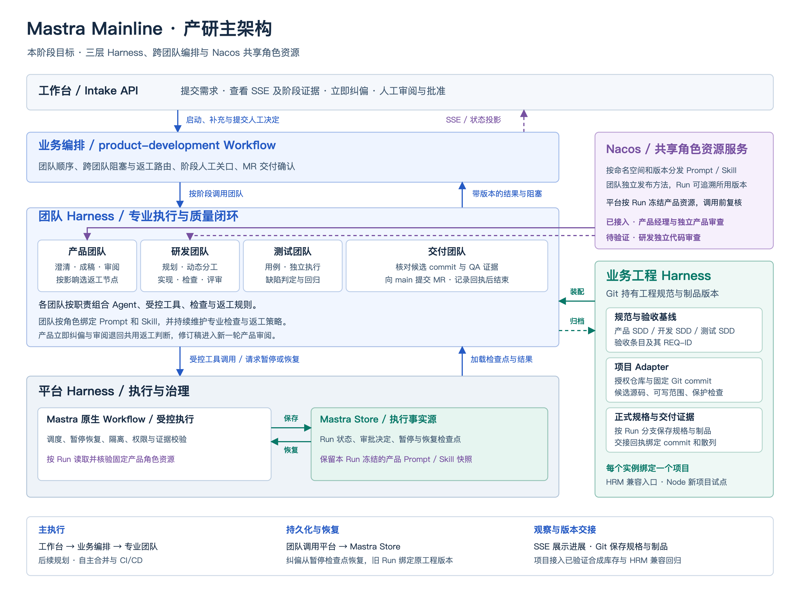
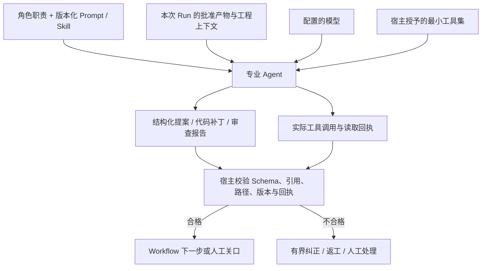
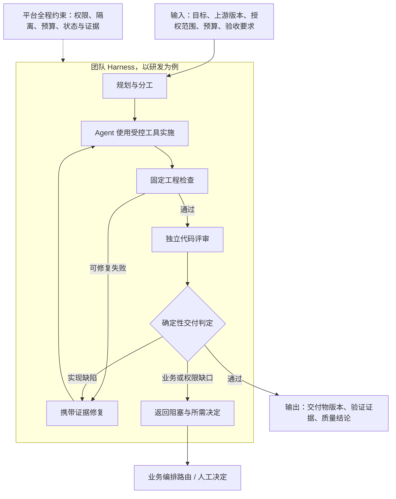
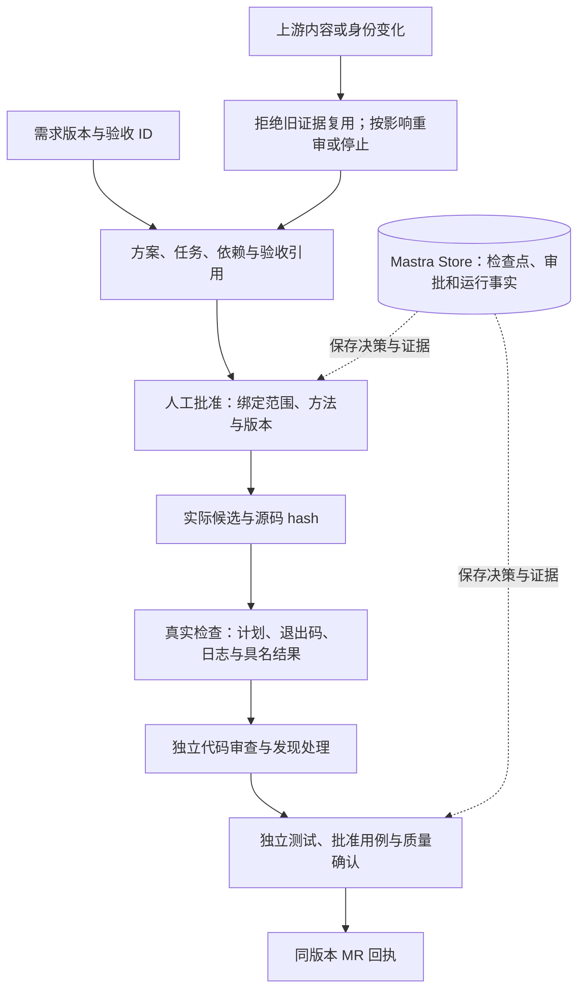

# 产研平台 Harness 架构

Mastra 主线按平台 Harness、团队 Harness、业务工程 Harness 三层组织能力。跨团队编排由 `product-development` Workflow 负责。职责划分、现有入口和验证范围见[三层 Harness 决策](../decisions/2026-11-19-three-layer-harness.md)。

本文解释当前架构与约束；行为契约以 [project-mainline OpenSpec](../../openspec/specs/project-mainline/spec.md) 为准。2026-11-21 的公共 Team Loop、双技术栈 Adapter 与 Run 级多项目增量见[接受决策](../decisions/2026-11-21-unified-team-loop-and-project-adapters.md)，不能用较早决策中的实施状态替代当前代码事实。

## 总体结构

[可编辑 Draw.io 源图](../assets/mastra-mainline-architecture.drawio) · [SVG](../assets/mastra-mainline-architecture.svg) · [流程及资源流详图](./visual-framework.md)

主图采用本阶段的交付目标。团队层由产品、研发、测试和交付四类团队组成，交付团队核对候选提交和对应的 QA 证据，从候选分支向 `main` 创建 MR，记录 MR 回执后结束本轮。自主合并、CI/CD 和部署在流程运行稳定后逐步建设。默认 Workflow 已按此装配。历史外部发布回执流程可按原试点图恢复。

Nacos 作为共享角色资源服务，按命名空间和版本分发 Prompt 与 Skill。产品经理和独立产品审查已接入，平台按 Run 保存冻结快照并在调用前复核原版本。研发独立代码审查以虚线标出，作为跨团队复用的待验证试点。详见 [Nacos 资源流](./visual-framework.md#nacos源资产冻结与角色装配)。

### 运行形态与 Agent 组合

当前是模块化单体：独立 React 工作台连接一个 Node.js / TypeScript Mastra 应用，应用内装配 Agent、嵌套 Workflow、API、Store 和评分器；模型服务、Nacos 与业务 Git 仓库在应用之外。团队与 Harness 是职责边界，不代表每个 Agent 都是一个服务，也不代表已抽成独立平台 SDK。依赖版本以根目录和 `web/` 的 package 文件及锁文件为准。

模型负责推理与生成；Agent 是角色职责、专业方法、任务上下文、模型、最小工具与调用策略的组合；Workflow 决定何时调用、分支、并发、循环和暂停；Harness 提供约束与验收保障。人工审批是独立关口，不属于模型权限。

| 执行单元 | 当前职责与权限 |
| --- | --- |
| 产品经理 / 独立产品审查 Agent | 分阶段写作与独立质量检查；不能代替人工批准 |
| 研发负责人 Agent | 只读核实项目规则与上下文，生成架构及任务包 |
| 研发评审 Agent | 实施前就绪审查与实施后只读代码评审，不修改候选 |
| 动态研发实现 Agent | 在批准任务及精确路径内实施；受限委派，固定检查，不获得任意 shell |
| 测试 Agent / 浏览器 QA | 测试计划与批准用例处理；执行结果由真实登记套件或浏览器回执证明 |
| 确定性节点 | 检查执行、版本核验、交付门与 MR 核验，不需要模型自证完成 |

产品资源从 Nacos 精确版本冻结；研发方法由本地 Skill 与 `method-lock.json` 锁定。大材料经登记引用、有界定位与分段读取进入任务上下文。Memory 按调用隔离并使用原生观察/反思，关闭语义召回和工作记忆，不是跨项目长期知识库。方法指导不授予工具或审批权限。详见[资源流](./visual-framework.md#nacos源资产冻结与角色装配)、[上下文配置](../../config/README.md#原生上下文配置)与[研发内部流程](./development-workflow-design.md#当前研发内部执行图)。

## 职责与依赖规则

| 职责 | 拥有的决定或资源 | 当前边界 |
| --- | --- | --- |
| 平台 Harness | 用 Mastra 原生 Workflow 和 Store 管理执行、暂停恢复、审批、隔离与版本校验 | 产品中止与检查点等待已经复用。研发执行作用域和预算仍由现有模块承载 |
| 团队 Harness | 团队内部角色协作、任务拆解、专业检查、返工范围和人工升级 | 产品经理与独立审查是角色。角色使用 Prompt、Skill 和受控工具，团队负责工作闭环 |
| 业务工程 Harness | Git 中版本化的产品、开发、测试 SDD，验收条目与保护检查 | 项目 Adapter 提供授权仓库、固定版本、候选基线、写入上界和检查入口。登记项目支持 `node-test.v1` 与 `python-unittest.v1`，HRM 走兼容入口 |
| 跨团队业务编排 | 调用产品、研发、测试和交付团队，安排交接、人工关口及跨团队回流 | 通过原生子 Workflow 编排，各团队输出带版本的结果、证据和阻塞 |

团队在平台授权范围内执行，并消费项目 Adapter 装配的 SDD 和检查。审批发生在对应的业务关口。Mastra Store 持有审批及恢复事实，Git 持有工程规格、源码基线及交付证据版本。默认交付保存已核验的 MR 回执。

## 团队内部闭环

这是职责示意。实际就绪审查、故障暂停、预算停止与恢复路径以现有 Workflow 为准，不能据此推导所有失败都可自动重试。每个团队 Harness 包含 Agent、工具、确定性规则与证据闭环，不能仅由 Prompt 或 Skill 代替。

团队保留自己的专业状态，通过公共信封和 Port 统一边界语义；当前公共控制已接入研发循环与测试返工，并非四个团队都已使用同一 Loop 实现：

| 契约语义 | 当前承载或约束 |
| --- | --- |
| 输入来源及版本 | `Delivery`、`StateV2.input.source`、产品及源码 hash |
| 授权与预算 | 范围确认、方案批准、路径上界、`autonomy.v1` 及累计调用账本 |
| 执行结果 | 专业 `outcome`、暂停及阻塞契约；`team-run-envelope.v1` 只读投影公共状态，不取代专业状态 |
| 交付证据 | `StateV2` 检查/评审/交付记录、`DeliveryLifecycle` 测试和 MR 回执 |
| 人工升级 | 当前原生 suspend/resume、阻塞澄清及明确终态；不新增任意终态续办 |
| 跨团队返工 | `rework-request.v1` 经研发 Port 校验目标版本、来源散列、证据与预算，再由研发内部策略更新状态 |

公共 Kernel 只作继续、返工、完成、阻塞或停止的纯决策，不调度、不持久化；实际循环仍由 Mastra Workflow 执行。详见[公共契约与项目路由](./team-loop-architecture.md)。

团队建设或调整自己的 Harness，需要版本化方法、检查及权限影响。实现 Agent 不得修改受保护检查、降低验收标准或自行扩权来获得通过；涉及既有批准内容时仍遵循对应审批与版本绑定规则。

## 当前代码归属与差距

一个文件可能同时包含多类职责。下表标识代码事实与目标归属，不能直接作为“已解耦”的证明。

| 职责 | 当前代码入口 | 当前差距 |
| --- | --- | --- |
| 应用装配与 Store | [`src/mastra/app.ts`](../../src/mastra/app.ts) | 已装配原生 Store、Agent 与 Workflow；不是完整独立平台 SDK |
| 业务编排 | [`product-development.ts`](../../src/mastra/workflows/product-development.ts) | 通过项目登记取得 Run 归属，仍负责资源初始化和最终交付团队装配 |
| 产品团队 | [`product-team.ts`](../../src/mastra/workflows/product-team.ts)、[`product-manager.ts`](../../src/mastra/workflows/product-manager.ts) | 保留产品专业方法与审批；不假设和研发具有相同自动返工语义 |
| 研发团队 | [`development-team.ts`](../../src/mastra/workflows/development-team.ts)、[`development-v2.ts`](../../src/mastra/workflows/development-v2.ts)、[`team.ts`](../../src/development/v2/team.ts) | 专业流程、授权校验与执行机制仍交织 |
| 测试与交付团队 | [`testing.ts`](../../src/delivery/testing.ts)、[`rework-port.ts`](../../src/development/rework-port.ts)、[`merge-request.ts`](../../src/delivery/merge-request.ts) | 测试通过返工 Port 请求研发续办，不直接改写研发状态。交付核对候选、QA 与正式规格，在 Run 分支提交候选并确认 MR |
| 平台中止与恢复 | [`interruptible-attempts.ts`](../../src/mastra/platform/interruptible-attempts.ts)、[`workflow-recovery.ts`](../../src/mastra/platform/workflow-recovery.ts) | 产品纠偏复用原生暂停及恢复，SSE 投影即时状态 |
| 通用机制候选 | [`execution-scope.ts`](../../src/development/v2/execution-scope.ts)、[`development-execution.ts`](../../src/development-execution.ts)、[`autonomy.ts`](../../src/development/v2/autonomy.ts) | Port、隔离、预算与专业返工策略仍绑定研发类型，不可整体直接改名为通用平台 |
| 公共团队控制 | [`contracts.ts`](../../src/team/contracts.ts)、[`loop.ts`](../../src/team/loop.ts)、[`rework-port.ts`](../../src/development/rework-port.ts) | 公共信封、纯决策与返工 Port 已接入研发和测试；不是所有团队共用的调度框架 |
| 业务工程 Harness 与项目适配 | [`project.ts`](../../src/business-engineering/project.ts)、[`adapters.ts`](../../src/business-engineering/adapters.ts)、[`hrm-execution.ts`](../../src/development/hrm-execution.ts) | Run 级绑定、Node/Python 固定检查与多项目路由已接入；真实业务和完整运行镜像仍需验收 |
| 方法资源 | [`nacos-resources.ts`](../../src/mastra/nacos-resources.ts)、[`methods.ts`](../../src/development/v2/methods.ts)、[`产品资源`](../../nacos-resources/product/README.md) | 产品远端资源与研发方法来源不同；不能把 Nacos 描述为全部团队运行底座 |

## 事实所有权

- Mastra Store 持有 Workflow 执行、审批和恢复事实。平台与团队是职责边界，不各自持有一套状态库。
- 候选目录承载源码，检查执行器产生原始结果，团队返回校验后的证据进入原生状态；源码文件不是审批事实。
- Git 交接、Run 档案、时间线和页面是产物或投影；不得以其覆盖原生执行状态。
- Nacos 和本地方法资源提供版本化执行材料，不能授予额外权限，也不负责流程恢复。

## AI 工程化证据链

模型提案、只读评审、真实检查、人工批准和远端回执分别记录，不互相替代。预算限制调用、检查、返工与无进展；可修复失败携带真实证据继续，业务决定、越权和完整性问题需人工处理，不能无限重试。恢复继续依赖原生快照、同版本输入与执行身份，不以时间线或文件归档推断状态。

评测分为固定控制流/契约回归、真实工程执行与真实模型质量。词项命中只提供回归信号，模型裁判也不替代批准或业务验收。评测结果用于审阅后更新方法与代码，不表示平台自动修改规则并投入生产。入口见[评测分层](../../evaluations/README.md)和[完整流程的证据追踪](./unified-workflow.md#需求到验收证据)。

## 三层渐进解耦试点

以产品纠偏和业务规格追踪为试点。平台 Harness 负责尝试中止和等待 Mastra 原生快照。产品团队 Harness 负责判断返工起点、还原产品检查点以及保留有效的上游产物。业务工程 Harness 由 Git 中的产品、开发和测试规格及其验收条目组成，项目适配负责把对应的仓库版本交给 Workflow。跨团队交接由业务编排负责。

| 改动场景 | 此次落点 | 可复现的验证 |
| --- | --- | --- |
| 更换业务工程的规则和测试 | 产品、开发和测试引用同一个[验收需求契约](../../src/business-engineering/acceptance-requirements.ts) | 在招聘和库存两个临时 Git 仓库提交不同产品规格和测试用例，通过既有回执固定 commit 和内容散列，验证分别命中各自受影响的用例 |
| 调整产品团队的返工判断 | [产品团队返工策略](../../src/mastra/workflows/product-rework.ts)管理节点选择、检查点和保留范围 | 对同一来源版本分别给出写作和范围起点，验证保留的上游产物范围 |
| 调整平台观察和恢复时机 | [平台尝试中止](../../src/mastra/platform/interruptible-attempts.ts)和[原生快照等待](../../src/mastra/platform/workflow-recovery.ts) | 对同一快照读取接口调整等待参数，验证超时和已保存暂停点的结果。产品流程继续通过原生暂停和恢复完成真实链路测试 |

试点回归位于 [`harness-boundaries.test.ts`](../../tests/harness-boundaries.test.ts) 和 [`guided-intake.test.ts`](../../tests/guided-intake.test.ts)。库存样例通过工作台主流程进入测试审阅，运行由 Git 版本登记的保护检查。

### 登记业务工程项目

在服务端通过 `MASTRA_ENGINEERING_PROJECTS` 登记项目数组，每项包含 `id`、显示名 `label`、本地 Git 根 `root`、受控 HTTPS `origin` 和完整 40 位 Git commit `revision`。同实例共用 Mastra Store，工作台只提交登记项目 ID，初始化后冻结 Run 绑定。历史 `MASTRA_ENGINEERING_PROJECT` 单项目配置保持独立 `projects/<id>` 数据目录，两种配置互斥。配置格式见[环境变量样例](../../.env.example)。未登记工程时默认入口继续使用 HRM 适配。

所选 commit 包含 `specs/product-sdd.md`、`specs/development-sdd.md`、`specs/test-sdd.md` 以及 `specs/engineering.json`。三个 SDD 分别进入对应团队的上下文。manifest 支持 `node-test.v1`（`src/**/*.mjs`、`test/**/*.test.mjs`）及 `python-unittest.v1`（`src/**/*.py`、`tests/**/test_*.py`），以 `sources`、`writable`、`checks` 声明候选、允许写入子集和保护检查，不接受任意命令。项目适配从同一 commit 自动发现根目录以及候选路径祖先目录中适用的 `AGENTS.md`，按父目录到子目录冻结为只读 `instructionFiles`；研发上下文 Agent 必须先产生全部真实读取回执，规则正文不能扩大 manifest 权限。固定检查计划由 Adapter 生成，产品、开发和测试的人工批准仍走原有工作流。

切换提交后，新 Run 使用新版本。旧 Run 需要以原项目配置和提交恢复。阶段同步使用该项目绑定的仓库，后继 Run 可从同一项目和仓库的较早 Run 获取已确认规格，同时采用当前登记的工程提交。

项目隔离贯穿产品上下文、候选执行、归档、同步、资产查询、后继与 MR；实现和运行时冻结边界见[Team Loop 与项目 Adapter 架构](team-loop-architecture.md)，并发与重启验收见 [`run-project-routing.test.ts`](../../tests/run-project-routing.test.ts)。这是项目路由隔离，不代表新增多租户身份或跨机器运行环境复现。

## 演进任务与验收

以下任务在架构约束和局部试点的基础上按依赖渐进推进。

| ID | 状态 | 范围与责任 | 验收与前置条件 |
| --- | --- | --- | --- |
| H0 | 已完成 | 平台维护者：职责图、代码归属、ADR、入口与协作规则 | 文档链接、差异检查；明确当前实现与目标边界 |
| H1 | 部分完成 | 公共信封与纯决策已抽取；预算、执行作用域仍部分绑定研发类型，保留专业修复策略 | 研发和测试为当前使用方；通用执行 Port 的进一步抽取需实际复用证据，保持预算与历史恢复语义 |
| H2 | 部分完成 | 测试→研发已使用版本化返工 Port；产品和交付尚未全面接入公共 Loop | `unified-workflow`、阻塞澄清与返工 Port 回归；禁止团队直接篡改其他团队状态 |
| H3 | Run 级路由已接入 | 服务端注册表冻结仓库、规格、版本、Adapter；上下文到 MR 按 Run 路由 | 多项目并发、重启、入口拒绝以 `run-project-routing.test.ts` 验收；真实业务与生产多实例待验 |
| H4 | Node / Python 已接入 | Adapter 生成固定检查计划并绑定运行时身份，各团队保留各自版本化方法 | 双技术栈真实进程回归；完整依赖镜像、更多技术栈与团队方法统一仍待推进 |

任何改变 API、配置、权限、状态、恢复或交付判定的实现，先更新 OpenSpec 再改代码。已有运行能力及其历史测试不能视为 H1–H4 已完成；本轮也不新增跨实例恢复、认证身份、自动发布或完整业务交付承诺。
