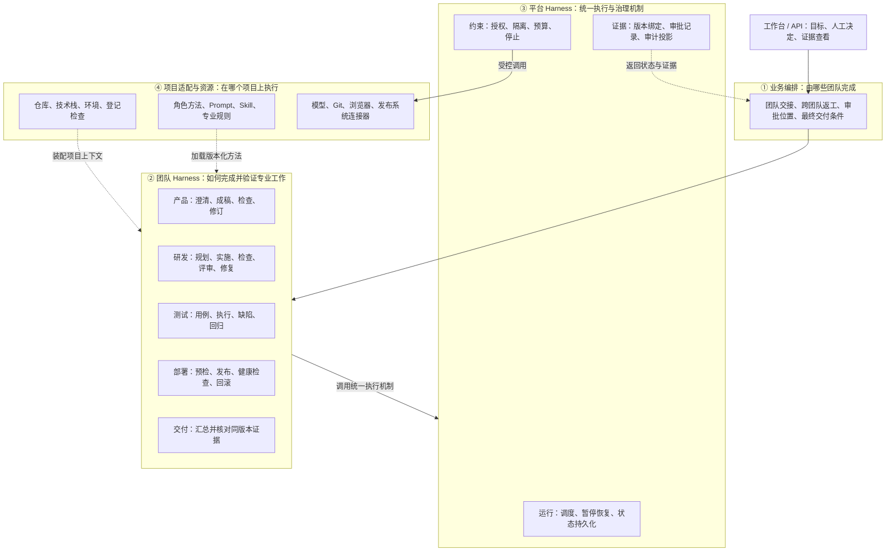
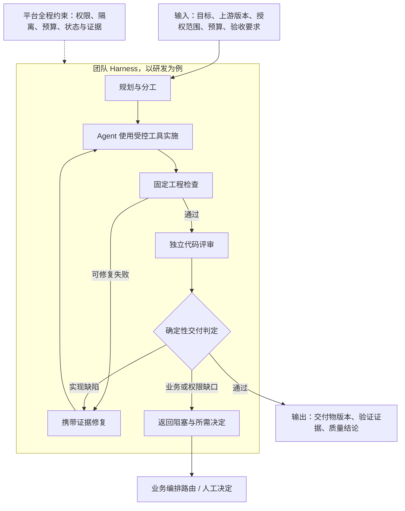

# 产研平台 Harness 架构

本项目采用“两类 Harness、四个职责区域”：平台 Harness 提供通用执行与治理机制，团队 Harness 定义专业工作的执行、验证与修复闭环；业务编排和项目适配分别管理跨团队协作与具体工程环境。

本页是后续开发的职责划分依据，不表示代码已按四个目录拆分。2026-11-18 已完成架构归属梳理，运行机制仍使用现有 Mastra 主线。选择理由见[架构决策](../decisions/2026-11-18-platform-team-harness.md)，实际运行步骤见[完整产研流程](./unified-workflow.md)，资料传递见[可视化框架](./visual-framework.md)。

## 总体结构

图中平台能力是职责目标；当前没有统一的跨团队预算服务、认证身份或自动 CI/CD 连接器。当前部署依赖外部执行及人工回填回执。团队也不因此成为独立服务：继续使用原生嵌套 Workflow，共享 Mastra Store 的运行事实。

## 职责与依赖规则

| 区域 | 拥有的决定 | 不应承担的职责 |
| --- | --- | --- |
| 业务编排 | 团队顺序、交接要求、跨团队阻塞路由、业务审批位置 | 团队内部修复算法、具体仓库命令、通用恢复引擎 |
| 团队 Harness | 专业任务拆解、角色协作、验收方法、缺陷分类、内部返工与升级条件 | 绕过平台授权、独立持有审批事实、直接修改其他团队内部状态 |
| 平台 Harness | 执行授权、预算计量和上限、隔离、原生持久化、证据完整性机制 | 判断需求是否完整、规定某技术栈业务断言、固定 HRM 路径 |
| 项目适配与资源 | 提供仓库和环境配置、登记检查实现、版本化方法资源、外部连接 | 通过配置扩大已批准权限、持有第二份运行或审批事实 |

依赖按职责约束，而非要求立即迁移目录：业务编排装配团队；团队调用平台执行机制和受控 Port；应用装配入口选择项目 Adapter 并注入。通用机制不反向依赖特定团队策略或 HRM 命令。项目 Adapter 可以实现 Port，但不能直接决定业务放行。

平台维护不可绕过的安全与完整性底线，团队定义专业规则。例如平台保证检查证据绑定当前版本，研发团队决定哪些检查和评审结论构成交付；检查套件的具体命令由项目适配提供。审批位置属于业务/团队策略，审批记录、版本校验和恢复机制属于平台。

## 团队内部闭环

这是职责示意。实际就绪审查、故障暂停、预算停止与恢复路径以现有 Workflow 为准，不能据此推导所有失败都可自动重试。每个团队 Harness 包含 Agent、工具、确定性规则与证据闭环，不能仅由 Prompt 或 Skill 代替。

团队对外至少应能说明以下语义；本轮不新增统一 Schema，也不改变当前字段：

| 契约语义 | 当前承载或约束 |
| --- | --- |
| 输入来源及版本 | `Delivery`、`StateV2.input.source`、产品及源码 hash |
| 授权与预算 | 范围确认、方案批准、路径上界、`autonomy.v1` 及累计调用账本 |
| 执行结果 | 各团队现有 `outcome`、暂停数据和阻塞契约；暂未统一为通用团队状态 |
| 交付证据 | `StateV2` 检查/评审/交付记录、`DeliveryLifecycle` 测试与发布证据 |
| 人工升级 | 当前原生 suspend/resume、阻塞澄清及明确终态；不新增任意终态续办 |

团队建设或调整自己的 Harness，需要版本化方法、检查及权限影响。实现 Agent 不得修改受保护检查、降低验收标准或自行扩权来获得通过；涉及既有批准内容时仍遵循对应审批与版本绑定规则。

## 当前代码归属与差距

一个文件可能同时包含多类职责。下表标识代码事实与目标归属，不能直接作为“已解耦”的证明。

| 职责 | 当前代码入口 | 当前差距 |
| --- | --- | --- |
| 应用装配与 Store | [`src/mastra/app.ts`](../../src/mastra/app.ts) | 已装配原生 Store、Agent 与 Workflow；不是完整独立平台 SDK |
| 业务编排 | [`product-development.ts`](../../src/mastra/workflows/product-development.ts) | 同时含 HRM 标识、资源初始化和最终交付团队实现，后续按需求分离 |
| 产品团队 | [`product-team.ts`](../../src/mastra/workflows/product-team.ts)、[`product-manager.ts`](../../src/mastra/workflows/product-manager.ts) | 保留产品专业方法与审批；不假设和研发具有相同自动返工语义 |
| 研发团队 | [`development-team.ts`](../../src/mastra/workflows/development-team.ts)、[`development-v2.ts`](../../src/mastra/workflows/development-v2.ts)、[`team.ts`](../../src/development/v2/team.ts) | 专业流程、授权校验与执行机制仍交织 |
| 测试、部署及交付团队 | [`testing.ts`](../../src/delivery/testing.ts)、[`deployment.ts`](../../src/delivery/deployment.ts)、主编排中的 `delivery-team` | 测试内部装配研发续办，跨团队返工边界尚待提取；部署依赖外部回执 |
| 通用机制候选 | [`execution-scope.ts`](../../src/development/v2/execution-scope.ts)、[`development-execution.ts`](../../src/development-execution.ts)、[`autonomy.ts`](../../src/development/v2/autonomy.ts) | Port、隔离、预算与专业返工策略仍绑定研发类型，不可整体直接改名为通用平台 |
| 项目适配 | [`hrm-execution.ts`](../../src/development/hrm-execution.ts)、[`hrm-verification.ts`](../../src/development/hrm-verification.ts)、[`repository-assets.ts`](../../src/delivery/repository-assets.ts) | 已有 Adapter，但主编排和服务配置仍包含 HRM 耦合 |
| 方法资源 | [`nacos-resources.ts`](../../src/mastra/nacos-resources.ts)、[`methods.ts`](../../src/development/v2/methods.ts)、[`产品资源`](../../nacos-resources/product/README.md) | 产品远端资源与研发方法来源不同；不能把 Nacos 描述为全部团队运行底座 |

## 事实所有权

- Mastra Store 持有 Workflow 执行、审批和恢复事实。平台与团队是职责边界，不各自持有一套状态库。
- 候选目录承载源码，检查执行器产生原始结果，团队返回校验后的证据进入原生状态；源码文件不是审批事实。
- Git 交接、Run 档案、时间线和页面是产物或投影；不得以其覆盖原生执行状态。
- Nacos 和本地方法资源提供版本化执行材料，不能授予额外权限，也不负责流程恢复。

## 演进任务与验收

本次只完成架构与协作约束落地。以下为待实施任务，按依赖渐进推进，不预建通用引擎或统一插件框架。

| ID | 状态 | 范围与责任 | 验收与前置条件 |
| --- | --- | --- | --- |
| H0 | 已完成 | 平台维护者：职责图、代码归属、ADR、入口与协作规则 | 文档链接、差异检查；明确当前实现与目标边界 |
| H1 | 待实施 | 平台与研发维护者：从 `autonomy.ts`、执行作用域识别可复用机制，保留团队修复策略 | 有第二个实际使用方再抽公共 Port；`development-autonomy`、`development-state-flow` 回归；保持预算与历史恢复语义 |
| H2 | 待实施 | 流程与团队维护者：明确团队交接、阻塞和测试返工调用边界 | 先评估并更新受影响 OpenSpec；`unified-workflow`、阻塞澄清回归；没有团队直接篡改其他团队状态 |
| H3 | 待实施 | 项目适配维护者：将主编排的 HRM 标识和装配选择收敛到项目适配边界 | 使用第二个真实项目需求验证，先定义配置/身份迁移契约；`hrm-execution` 回归，保留现有项目数据关联 |
| H4 | 待实施 | 各团队维护者：分别登记专业验收套件与方法版本 | 在批准范围和独立环境验证通过/失败/升级路径；fixture、真实模型与业务验收分别报告 |

任何改变 API、配置、权限、状态、恢复或交付判定的实现，先更新 OpenSpec 再改代码。已有运行能力及其历史测试不能视为 H1–H4 已完成；本轮也不新增跨实例恢复、认证身份、自动发布或完整业务交付承诺。
