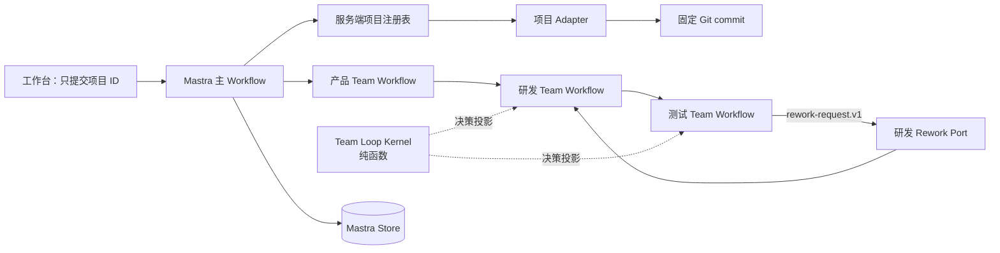
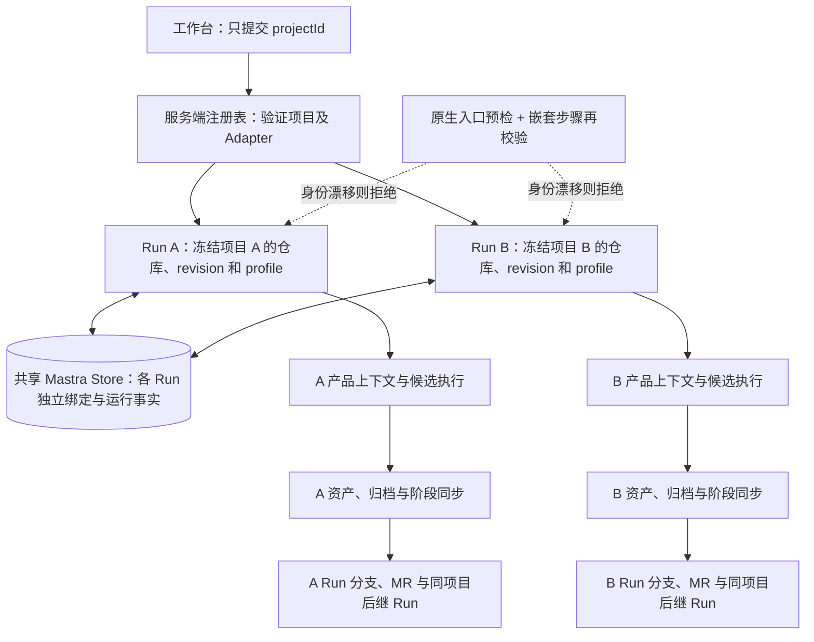
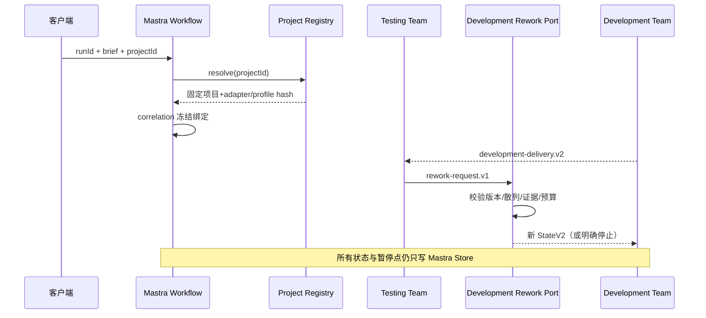

# 平台通用 Team Loop 与项目 Adapter 架构

> 实施状态（2026-11-21）：研发与测试已接入信封、纯决策和返工 Port；检查计划由 Adapter 生成，新 Run 的 profile 绑定计划模板和解释器可执行文件版本、摘要。Run 级项目注册表、工作台选择及产品上下文、候选、归档、同步、后继与 MR 路由已接入；并发、重启和原生入口拒绝场景以 `tests/run-project-routing.test.ts` 为验收入口。完整验证结果记录在关联 ADR，不能将 fixture 或受控端口验证解释为真实远端交付。

## 1. Scope

本设计补齐团队 Harness 的公共边界：统一运行信封、停止/返工决策、跨团队返工 Port、项目 Adapter 注册与 Run 级冻结。它不统一产品、研发、测试的专业状态，不创建新调度器、审批器或持久层，也不允许项目清单提供任意命令。

独立团队运行与回归套件正在按[OpenSpec 变更](../../openspec/changes/add-independent-team-runs/proposal.md)推进。统一 `team-run-input.v1` 输入信封只接纳团队、项目、版本化来源引用和团队专属载荷；从既有 Run 取数时，服务端须重读 Store 与 Git 回执。新增团队入口不得把内部子 Workflow 直接暴露为 HTTP 输入，也不得把来源 Run 的状态复制成新的权威事实。

规范输入的首版 Schema 位于 [`src/team/independent-run-input.ts`](../../src/team/independent-run-input.ts)。独立产品 Workflow 已登记到 Mastra，当前只接受新需求，复用产品团队及人工审批并输出版本化结果；研发、测试和交付的独立入口、专用 API 和工作台仍未接通。输入散列不替代来源证据，下游正式启动仍需完成服务端来源解析和冻结绑定。

来源解析的初步实现位于 [`src/team/independent-run-source.ts`](../../src/team/independent-run-source.ts)：按来源类型读取主流程或对应独立团队的 Store 快照，校验项目及来源 Run 身份，并在 live 模式读取固定 Git 规格回执；不兼容的来源 Workflow 会在读取前拒绝。fixture 回归已验证从独立产品 Run 读取批准结果；下游独立运行入口、候选复制、来源冻结和恢复时重验仍待实现。

## 2. Impact

| 责任 | 归属 | 变化 |
| --- | --- | --- |
| Workflow、暂停、审批、恢复事实 | Mastra Workflow/Store | 保持唯一事实源 |
| Team 信封、停止语义、交接 Port | 平台 Harness | 新增版本化契约与纯决策 Kernel |
| 产品/研发/测试专业策略 | 团队 Harness | 保留各自 Schema；通过投影和 Port 接入 |
| manifest、路径、固定检查计划 | 项目 Adapter | 从 Node 专用装配中拆出并登记 |
| 仓库、固定提交、Run 项目绑定 | 项目适配/业务编排 | 服务端按 ID 选择并在初始化冻结 |

历史 Run 继续使用原 Schema 和工厂；新字段不反向猜测或重写历史快照。

## 3. Design

公共控制当前已接入研发与测试，产品与交付并未全面接入同一公共 Loop。`team-run-envelope.v1` 只投影 `teamId/status/phase/inputVersion/budget/evidence/blocker/stopReason`。它不单独保存，序列化它也不能成为恢复依据。`rework-request.v1` 是跨团队输入；研发 Port 校验目标团队、研发状态版本、来源 checkpoint、finding、证据引用和剩余返工预算后，才调用研发内部返工策略。

项目 Adapter 注册表以不可变 ID 选择预注册实现：

- `node-test.v1`：`src/**/*.mjs`、`test/**/*.test.mjs`，固定 Node 语法与 `node:test`。
- `python-unittest.v1`：`src/**/*.py`、`tests/**/test_*.py`，固定内存 `compile()` 与逐登记文件的标准库测试加载；拒绝零测试成功，不生成候选内的编译缓存。

manifest 只声明文件集合，不声明可执行命令。Adapter 生成固定 argv，受控执行 Port 在禁网、只读候选的 OS 沙箱中运行。

服务端通过 `MASTRA_ENGINEERING_PROJECTS` 登记项目数组，与历史 `MASTRA_ENGINEERING_PROJECT` 互斥。注册表模式共用一个 Mastra Store；客户端从 `/intake-api/projects` 获取 ID 和名称，创建 Run 时必须显式提交 `projectId`。未知项目、重复 ID、不同 ID 指向同一真实仓库根均拒绝。旧 HRM 和单项目模式保持原入口及同步设置路径。

初始化的 correlation 由 Mastra Store 保存，冻结 root/origin 的绑定摘要、revision、Adapter profile 和项目交付契约摘要；浏览器不能提供 root、revision 或命令。项目交付落点按项目 ID 保存在平台项目数据目录，版本文件不可变；新 Run 冻结当前摘要，恢复继续读取该版本。需求和产品规格交接必需，失败时下游停在可恢复点。原生 Run 入口在框架修改快照前校验绑定，步骤包装在资产和执行适配外层再次校验。异步作用域只传播已验证的项目配置及根 Run 标识，不保存审批或恢复事实。条件分支可能丢失框架父级元数据时，内部步骤继承外层已验证来源；缺乏权威来源时拒绝，不按输入猜测归属。

资产目录、文件和 bundle 在注册表模式必须提供项目 ID；远端阶段策略按项目隔离，MR 的仓库从同一 Run 绑定解析。后继 Run 从来源项目的固定 Git 回执读取规格，可采用该项目当前登记 revision，不继承审批。活动 Run 恢复仍要求原绑定；旧成功 Run 可只读查看并作为后继来源。

### Run 级多项目数据路由

项目路由不依赖共享可变的“当前项目”。异步作用域只传递已验证绑定；相同资产 hash 也不能绕过项目归属。恢复以 Store 的冻结绑定为准，重排注册表不能改变既有 Run。该能力不等同于多租户授权、跨进程创建幂等或跨机器恢复服务。

## 4. Implementation

实施顺序为：先更新 OpenSpec 与接受 ADR；再增加公共契约/Kernel 和研发返工 Port；随后抽取 Adapter 注册表与固定执行计划；最后接入 Run 绑定和双技术栈回归。代码入口通过 ADR 注释反向链接本决策。

## 5. Risks and validation

- 双事实源：信封不得拥有仓储 API；测试应证明它可由专业状态重复投影。
- 越权执行：manifest 中出现命令、绝对路径、隐藏路径或未登记 Adapter 必须拒绝。
- 恢复漂移：Run 绑定中的 revision、Adapter 或 profile hash 任一变化都必须拒绝恢复。
- 环境偶然性：Python 首版使用标准库测试；pytest 需在后续受控镜像中固定版本后再登记。
- 可复现边界：解释器可执行文件与版本已绑定，但标准库、动态库和完整运行镜像尚未冻结，不能承诺跨机器环境复现。
- 回归遗漏：Node 与 Python 都必须生成真实进程退出码、具名测试结果和检查前后快照一致性证据。
