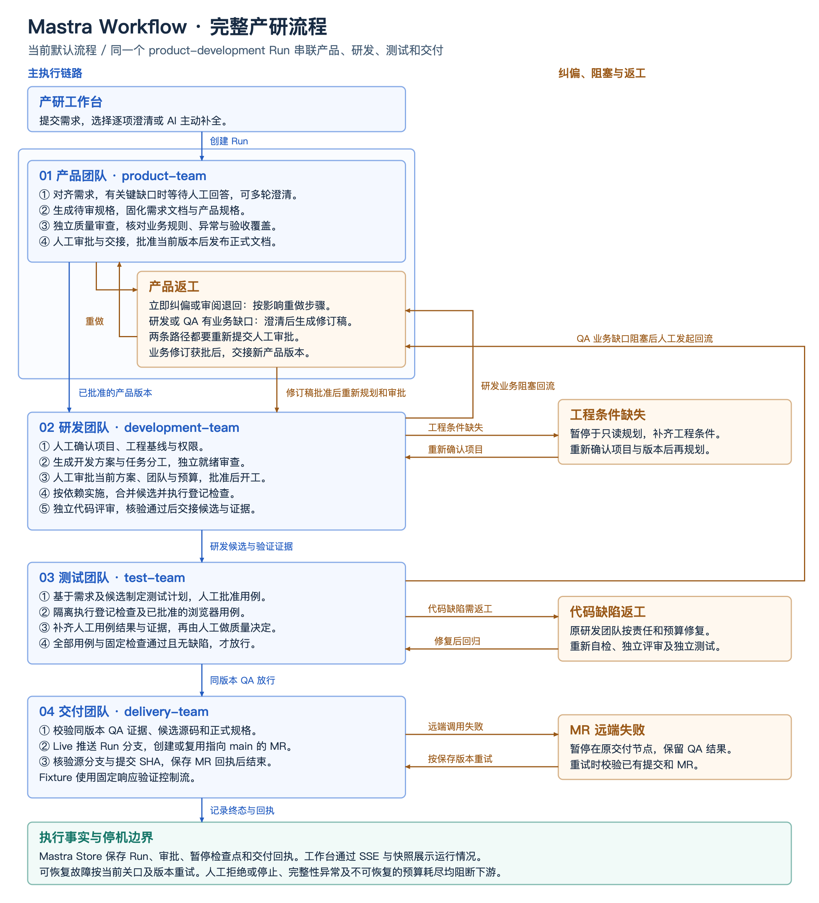
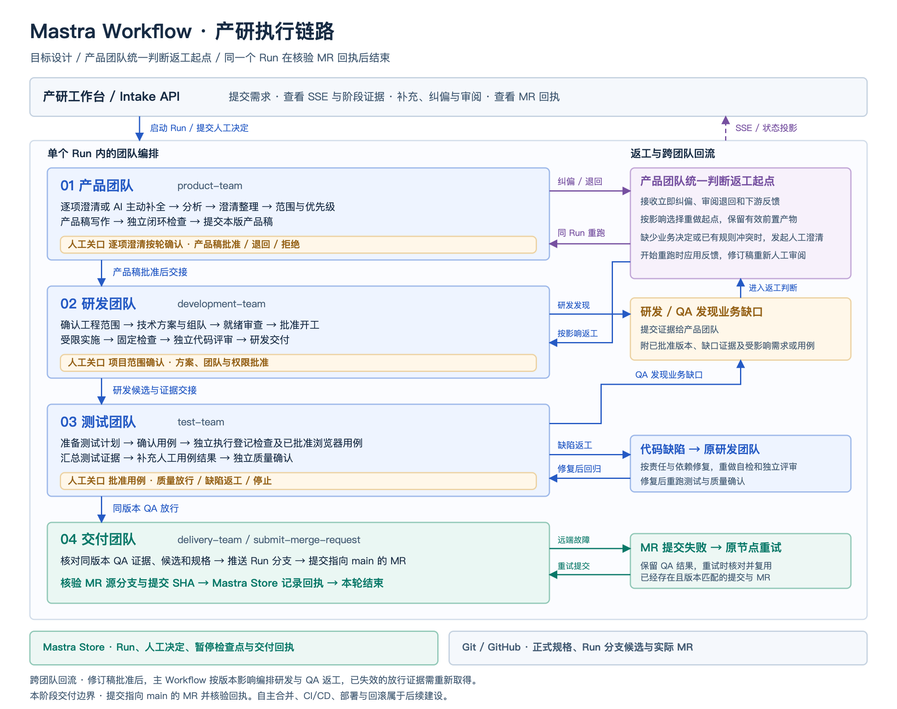

# 完整产研流程

架构归属见[Harness 架构](./harness-architecture.md)：本页的 `product-development` 是平台承载的产研业务编排，团队 Harness 承担专业闭环，平台 Harness 提供执行治理，业务工程 Harness 经项目 Adapter 提供 Git 规格、候选与检查。

主流程、Git 数据流和 Nacos 资源流的分色视图见[产研可视化框架](./visual-framework.md)。该视图按责任团队归属组织，研发阻塞后的产品澄清仍位于产品团队。

当前 Studio 业务主入口为 `productDevelopmentWorkflow`（内部 ID 为 `product-development`）。默认主流程由四个团队 Workflow 组成，依次为 `product-team`、`development-team`、`test-team` 和 `delivery-team`。团队内部步骤用于暂停、恢复、审计和责任定位。

## Workflow 执行链路图



[查看原尺寸 PNG](../assets/mastra-workflow-current.png) · [SVG 矢量图](../assets/mastra-workflow-current.svg) · [Draw.io 可编辑源图](../assets/mastra-workflow-current.drawio)

蓝色箭头表示同一 Run 内的阶段交接，琥珀色箭头表示纠偏、阻塞、返工和交付重试。Live 模式交付已核验的 MR 回执，默认流程在此结束。启用阶段资料远端同步时，失败可从已保存的产物重试同步。更多节点 ID 和操作入口见下方「工作台与 Studio」。

图中的「产品返工」共用 `product-rework.v1` 路由判断。立即纠偏和待审稿退回按影响重跑产品节点。研发和 QA 已记录的业务缺口直接进入同一 Run 内的 `resolve-development-blockers` 人工澄清，原生检查点保存来源产品版本、返工决定与已有发现引用。QA 先保存阻塞结果，再由人工发起澄清。修订稿获批后，研发按新版本重新规划并等待开工审批，随后重新验证和测试。

### 历史执行链路图

以下图档记录产品三阶段版本的产研执行链路。

[历史图 PNG](../assets/mastra-workflow-execution.png) · [Draw.io 可编辑源图](../assets/mastra-workflow-execution.drawio) · [SVG](../assets/mastra-workflow-execution.svg)

### 产品返工目标链路

下图保留最初的目标设计。当前默认链路已将下游业务缺口接入共享返工判断，并按缺口类型固定进入人工澄清。当前链路的入口和关口以上方执行图为准。



[Draw.io 可编辑源图](../assets/mastra-workflow-target.drawio) · [SVG](../assets/mastra-workflow-target.svg) · [PNG](../assets/mastra-workflow-target.png)

研发节点收敛前创建的 Run 使用 `MASTRA_LEGACY_DEVELOPMENT_WORKFLOW=true` 装配原执行图，按原有暂停路径恢复。新图在生成开发方案步骤内保存上下文，在审查步骤内保存发现及人工裁决。并行任务与固定检查各自保留原生检查点，开发交付绑定同一批准方案与候选源码版本。

新研发 Run 从 `MASTRA_DEVELOPMENT_CONTINUATION_LIMIT` 读取技术故障接续上限，默认 4，取值 0–72。额度在初始化时绑定，同一 Run 的已批准业务澄清会继承累计次数。模型调用、代码返工和登记检查仍使用各自的预算。

可识别的瞬时模型故障、可纠正的输出校验失败和可复验的检查环境故障由研发流程自动接续。工作台展示失败步骤、处理动作、复验结果和对应版本。原因未知或自动接续耗尽时，工作台显示待研发或平台处理。代码与已批准规则不符时，以原规则和登记检查为依据修复。规则缺失或需要变更时进入产品澄清，批准修订后再继续。

### 平台依赖修复通知

应用启用 `MASTRA_PLATFORM_REPAIR_TOKEN` 后，已分类且仍有额度的模型服务或登记检查环境故障可进入「等待平台修复」。通知方通过 `Authorization: Bearer <token>` 访问 `GET /platform-api/runs/:runId/dependency-repair`，获取当前等待的 `dependency`、`faultId` 和 `checkpoint`。平台完成相应修复后，通过同路径 `POST` 提交 `faultId`、`checkpoint` 和一个稳定的 UUID `eventId`。工作台自动同步等待、接续和复验状态。

响应 `accepted` 表示原生状态已记录事件。平台接续的实际结果以工作台复验记录为准。`duplicate` 表示该暂停版本已收到修复事件。`processing` 返回 HTTP 202，调用方可用同一事件回查。`stale` 返回 HTTP 409，表示等待版本已经变化或当前 Run 无对应暂停点。源码检查点、原审批和累计预算在接续时重新核验。

试运行可从 `GET /intake-api/runs/:runId` 的 `recoveryMetrics` 读取技术故障数、重复故障数、完成的自动接续、通过次数、已验明的修复、平台事件以及人工技术决定、业务澄清与技术方案审批次数。将同类场景、相近输入和相同验收规则的试点前后 Run 分组，按每个 Run 的人工技术决定次数或每个观察到的技术故障的人工决定次数比较。`legacy-partial` 表示历史字段覆盖不完整，应单列样本。

### 工作台与 Studio

日常操作按 [README](../../README.md#快速启动)启动后端与前端，打开[产研工作台](http://127.0.0.1:4112/)；所有人工关口可在工作台完成。以下 Studio 图和 Resume JSON 供技术调试及契约查阅。

工作台按服务端登记项目组织需求，注册表模式新建 Run 必须显式选择项目 ID；历史单项目与 HRM 使用原兼容入口。项目行的新增入口打开居中的填写引导，底部共用输入框根据原始描述提炼列表标题。执行记录在待办上方，流程浮层和右侧材料栏按需打开。架构方案、测试用例和测试结果使用当前暂停关口的审查材料，审批仍提交该关口的版本标识。

实时输出保留在打开的 Run 视图中，可折叠回看。刷新后恢复的是 Store 快照与正式回执。通用输入可加入澄清或审阅草稿，其余补充作为本页记录。截图只在输入区本地预览。语音输入暂用浏览器语音识别，最长 60 秒。浏览器可能通过其语音服务处理音频，工作台将识别结果追加到可编辑草稿，由用户提交。Mastra 转写接口保留供后续恢复接入。


启动后端 `npm run dev`，打开 `http://127.0.0.1:4111/workflows/productDevelopmentWorkflow/graph`。首次输入 `{ "iterationId": "recruitment-001", "brief": "你的需求" }`；迭代未指定时默认 `unassigned`。图中的 Workflow 可展开查看产品、开发、测试与交付子步骤。主链保持一个 Run，各角色在自己的子流程内扩展。

```text
原始需求
  → product-team
       ├─ align-product-requirements｜对齐需求，多轮澄清或形成方向建议
       ├─ product-writing｜生成待审规格，校验并固化需求文档和产品规格
       ├─ review-product-quality｜独立质量审查，核对规则、异常和验收覆盖
       └─ review-product｜人工审批与交接，批准当前版本后发布
  → route-product-team-result：仅批准版本进入下游
  → development-team
       ├─ confirm-project-scope｜确认项目与权限
       ├─ plan-development｜生成开发方案，核实上下文、拆分任务与组队
       ├─ assess-readiness｜独立就绪审查，必要时暂停等待人工裁决
       ├─ approve-architecture｜人工审批开工，绑定当前方案、团队和预算
       ├─ develop-and-check｜按方案实施与验证，按依赖波次执行并跑登记检查
       ├─ review-development-quality｜独立代码评审与交接，核对当前候选证据
       └─ 发现业务缺口时，经 resolve-development-blockers 回流产品团队
  → test-team
       → test-and-regression-cycle：独立测试、缺陷回归和质量确认
       prepare-test-plan：测试角色读取需求与实际源码
       approve-test-cases：确认用例、预期、需求与登记检查映射
       execute-tests：隔离环境重跑登记套件
       execute-browser-qa：QA Agent 加载固定方法并执行批准浏览器用例
       review-test-results：补充人工用例结果，确认质量
       通过 → delivery-team
       缺陷 → route-test-defects → 原开发团队修复/自检/评审 → 重新测试
  → delivery-team
       submit-merge-request：核对同版本 QA、候选与正式规格，提交指向 main 的 MR
```

逐项澄清中，用户选择提交并推进后，Workflow 重新评估业务缺口。已收敛时直接写作，尚有缺口时暂停等候业务决定。已有 Run 可按对应的历史图配置恢复，见[产品团队 Workflow](./product-workflow.md#恢复历史-run)。

产品、项目范围和方案在同一个原生 Run 中暂停与恢复。产品待审稿退回和生成中的立即纠偏共用团队返工策略。团队按影响选择最早重做节点，新稿在同一 Run 重新审阅。开发模型故障保留失败任务和已合并的成功任务，连续故障后原阶段暂停，可多轮人工继续；不承诺强杀或跨实例的原子恢复。

开发阶段使用原生条件分支：只有当前阶段执行，未执行节点不会因空返回而完成。可恢复模型故障在原阶段暂停，页面解释阶段、原因和具体重试动作；历史 `recover-development` 暂停点保留兼容。连续自动尝试或调用额度耗尽会暂停等待恢复/追加额度，用户选择停止则保存阻塞终态；开发未交付时不启动测试/发布。图中 `state-after-*` 为状态传递节点，其完成不代表相邻业务阶段已完成。[状态决策](../../docs/decisions/2026-11-08-mastra-stage-state-flow.md)。

## 运行时限与上下文

开发角色单模型步骤时限为 10 分钟，每次 Agent 执行总时限为 30 分钟（`development-timeout.v3`），不把整个研发阶段或人工等待限制为 30 分钟。临时模型故障每轮最多 5 次尝试（含首次），退避后仍失败在原阶段暂停；可多轮人工继续，追加调用额度不清零累计计数。技术故障接续另受 Run 初始化的上限约束，不能把模型重试、代码返工和检查预算混为一项。

每次失败保存来源、实际触发时限、耗时、UTC 时间与调用序号，历史未采集字段不补猜。恢复须通过检查点和身份校验，不跳过方案批准，也不承诺进程强杀或跨实例副作用的原子恢复。

live 角色使用 Mastra 原生 Observational Memory，每次调用/重试使用独立 thread/resource；观察与反思沿用当前角色模型和出口。默认估算 24000 消息 token 触发同步观察，12000 观察 token 触发反思。这是压缩阈值，不是资料容量或人工门槛；语义召回与工作记忆关闭，不构成共享跨项目知识库。

资料按登记 ID 和固定版本定位、分页与分段读取，单次返回有界，不设置累计读取、初始目录总量或 provider 请求体字节的业务门槛，不要求资料升档。provider 溢出时启用原生观察后按政策重试，压缩失败仍走检查点恢复；旧资料预算故障无需升档即可继续。压缩会增加模型调用且可能损失细节，不能保证任意窗口或事实零遗漏，原文应可重读，审批只认 Store。配置权威见[上下文配置](../../config/README.md#原生上下文配置)。

## development-team：项目范围确认与研发交付

当前 HRM 前端在 `confirm-project-scope` 确认关联项目、代码版本、确认人、交接说明及自主执行预算。服务端从固定仓库装配源码、源码根权限上界、只读检查文件和任务角色候选池；浏览器不能自报全栈执行档或上传源码替换基线。`development-lead-agent` 决定具体文件、任务依赖及所需任务角色；`development-implementer-agent` 按批准任务动态创建，仍需人工批准架构方案后才实施。自检和交付评估属于 Workflow 确定性门禁，不创建 Agent。

HRM 执行档为 `hrm-pnpm-docker-v1`，`planning=agent`。检查登记为 `project:check/build/smoke`，通过 Docker/Compose 在源码副本和临时数据库中运行 `pnpm check/build/smoke`；前两项禁网，smoke 仅连内部测试网络，不使用宿主 `.env`。新增文件限已授权源码根，依赖清单、锁和固定检查不可修改。当前 smoke 验证页面、API 与数据库健康，业务断言需后续随需求补充。

以下 JSON 保留为 CLI/Node fixture 兼容格式，不是当前 HRM 前端的填表要求。`files` 是显式提供的初始源码，`writablePaths` 是精确写权限，`checkFiles` 必须存在且不可写。旧执行器支持受限 Node `.mjs` 语法检查及登记的 Node 检查，不支持任意项目命令。

```json
{
  "project": {
    "id": "my-project",
    "files": {
      "src/frontend.mjs": "export const view = '';\n",
      "src/backend.mjs": "export const response = {};\n",
      "checks/contract.mjs": "import test from 'node:test';\nimport assert from 'node:assert/strict';\nimport { view } from '../src/frontend.mjs';\nimport { response } from '../src/backend.mjs';\ntest('frontend/backend contract', () => { assert.equal(typeof view, 'string'); assert.equal(typeof response, 'object'); });\n"
    },
    "writablePaths": ["src/frontend.mjs", "src/backend.mjs"],
    "checkFiles": ["checks/contract.mjs"],
    "roles": ["frontend", "backend"]
  },
  "reviewer": "项目负责人",
  "comment": "确认需求版本与文件授权",
  "maxReworks": 3,
  "autonomy": {
    "version": "autonomy.v1",
    "maxCheckRuns": 24,
    "maxNoProgress": 2
  }
}
```

示例只说明格式，不是实际业务验收。业务代码目标为 `leidaibo-lab/hrm`，执行器写独立候选目录，已接通整仓 pnpm 验证，已接通角色资料与候选源码副本的远端交付分支，尚未将候选代码合入业务源码分支。输入、候选文件保存在当前数据目录的 `development-runs/<Run标识散列>/`。原生 LibSQLStore 保存流程事实；候选目录不创建第二套审批库。授权人是本地标签，当前未接入认证。

### 确认开发方案

新建 live 主线 Run 在「确认开发方案」中展示开发架构文档、影响范围及架构图和关键业务数据流图。「查看本次确认依据」保留结构化任务、文件、就绪结论与预算。研发负责人和独立就绪审查使用同一版架构文档方法。审批版本同时绑定正文、图和任务包。

批准后，`specs/development-architecture.md` 与 `specs/development-spec.md` 在同一正式 Run 分支一起提交。历史 Run 仍按原方法版本和原暂停点恢复。

研发页的「代码变更」入口按需展开右侧栏。按文件折叠查看本轮开发输入基线与已保存候选间的差异，可在行内和并排视图间切换。刷新变更可读取当前已保存的检查点。若候选内容与检查点不一致，页面会提示暂不可查看。

## 团队、委派与数据边界

成员由任务包动态生成，包含 `id/role/taskId/paths`，团队参与批准包散列。前后端任务无依赖且写入路径互斥时可同时执行。多个任务写入同一授权文件时，通过 `dependsOn` 直接或间接确定先后顺序。后续任务在前序补丁合并后，从更新的候选检查点读取文件。历史 Run 继续使用已绑定的任务交接方法。每个成员读取同一波次快照，在独立临时候选目录工作，屏障后由宿主校验并合并成功补丁。

任务负责人通过原生工具 `delegateTask` 创建子 Agent，自主选择已登记角色、目标和父任务路径子集。最多3次、深度1；子任务路径须无重叠且覆盖父任务。父成员无直接写工具，子成员无继续委派工具。委派目标、角色、路径、父子 ID 和输出/源码散列持久化；父子调用共用72次预算。任意角色、宿主文件、命令或无限递归未开放。

Zod schema 约束跨模块数据，步骤返回新状态；补丁映射按文件定位，完成任务按 ID 管理。工厂模式创建动态 Agent，执行作用域适配器隔离每个 Run 的 I/O，原生 Workflow 负责调度和持久化。自有适配只负责依赖波次、授权及补丁合并，不另建通用引擎。

## 批准范围内自主开发与排障

工作台确认开发项目时直接绑定 `autonomy.v1` 的默认预算。实施方案批准时可查看预算，包括最多3轮返工、累计72次开发模型调用和24次登记检查套件执行。连续2次出现与上一轮相同的失败签名时停止自主返工，首次失败建立基线。需求、任务和实施范围批准后，团队连续完成实现、集成、常见错误修复和验证。旧输入没有 `autonomy` 时沿用原政策及已保存的批准和恢复散列。

每次实际检查追加 `verificationHistory`，包含命令、退出码、脱敏有界输出、超时/截断标记、耗时、源码散列、角色、任务路径、轮次及用途。工具检查、合并后的独立复跑和独立测试分别绑定自己的候选版本；失败分支即使回滚补丁，也保留检查证据。`repairHistory` 保存失败签名、责任任务、问题分类和无进展次数；后续角色同时获得检查、返工、模型失败及既有评审记录。流程状态仍由原生 Store 保存，候选目录不成为第二套事实源。

实现者与任务负责人获得无参数 `runChecks` 工具，只能运行已登记检查，不能自填 shell 命令、修改检查文件或安装依赖。并发分支按剩余额度预分配检查次数，并预留2次给整体自检及宿主独立复跑；父子任务与失败重试共享分支账本。达到分配上限也会停止，因此停止时实际总次数可能小于总上限。分支检查不能代替合并后检查，模型吞掉工具预算异常也不能交付。

前后端等多责任代码缺陷在已批准团队内联合修复，依据角色、文件和任务引用重跑责任任务及依赖下游，保留无关完成任务。无法定位时保守重跑批准团队。范围内契约缺陷不重新请求方案批准；确实改变批准设计时才回到规划和批准。修复后重新运行全量登记检查和独立评审，旧发现须逐条复评。

临时网络/超时按既有5次尝试及退避处理；格式错误携带安全诊断有界修正。代码缺陷按当前证据返工，环境错误保留分类并仅在原执行环境和权限内排障。失败检查和未解决发现发生变化才视为新证据，单纯修改源码、时长或报告顺序不算进展。达到返工、检查、模型或无进展预算后升级人工；业务缺口与权限/完整性问题立即停止。工作台展示具体停止原因、已消耗次数和最近检查输出。检查/返工停止保存终态和候选，本次未增加该终态的任意续办入口；既有模型阶段暂停仍沿原恢复入口处理。

该闭环已覆盖真实 Workflow、隔离 Node 检查和持久化回归，尚未完成真实模型在 HRM 上的完整业务自主交付验收。独立测试用例批准、人工用例确认及发布审批/外部回执仍按各阶段约定处理。[选型、验收及剩余边界](../../docs/decisions/2026-11-09-mastra-autonomous-development.md)。

## 需求到验收证据

新建 live Run 的产品稿包含带稳定 `REQ-` ID 的可验收条目，格式为 `- REQ-APPLICATION-SUBMIT: 提交申请 | 验收: 返回申请编号`。人工确认时同时批准条目和正文。研发任务与测试用例引用这批 ID，宿主核对结构覆盖，测试负责人核对业务语义。历史 Run 继续使用已保存的原文锚点和审批版本。

工作台的「需求验收证据」按 ID 展示研发任务、已批准用例、执行结果及来源，并绑定产品、开发方案和候选版本。阶段归档的 `acceptance-evidence.json` 是同一原生状态的只读投影。

业务澄清形成修订稿时，审批页显示新增、修改、移除的需求与受影响的历史用例。保留的用例须在重新批准的用例包中执行，新增需求须补齐覆盖。新版继续执行全量质量门。旧稿使用行号锚点时，系统提示完整回归。

## test-team：测试用例、质量确认与回归

`test-team` 消费研发交付与同一份候选源码，独立生成计划，不复制开发自检当作独立执行结果。其内部 `test-and-regression-cycle` 负责测试计划、用例批准、执行、质量确认和缺陷回归。`approve-test-cases` 的 Resume 示例：

```json
{
  "hash": "使用暂停信息中 plan.hash 的实际值",
  "decision": "approve",
  "reviewer": "测试负责人",
  "comment": "确认全部需求的正常、边界、异常覆盖",
  "cases": [{
    "id": "case-1",
    "requirementRefs": ["使用暂停信息中的实际需求ID"],
    "expected": "填写可检查的预期结果",
    "method": "registered-check",
    "checkRefs": ["使用 registeredChecks 中实际存在的检查ID"]
  }]
}
```

用例 ID 唯一，全部已批准需求须有映射。自动用例只能引用登记检查；人工用例使用 `method: "manual"` 和 `checkRefs: []`。覆盖的业务语义由测试负责人负责，检查引用不能证明未执行的路径。

实际套件执行后，`review-test-results` 暂停。Resume 含当前 `hash`、`decision: "pass" | "rework" | "stop"`、`reviewer`、`comment`、`manualResults`、`findings`。人工结果逐项填写 `{caseId,status,evidence}`，status 为 `passed/failed/blocked`；自动结果不能被人工覆盖。全部用例通过、固定套件成功且无缺陷才允许 `pass`。

返工需要具体 `findings`，结构沿用开发评审的 `id/category/severity/route/detail/refs/evidence`，引用必须属于当前需求/任务/文件证据，责任角色必须已登记。缺陷通过原开发继续入口修复，沿用累计返工和调用预算；修复后重新自检、评审和独立测试。`qualityHistory` 与 `developmentHistory` 保存旧测试及交付记录。业务、完整性问题或预算耗尽停止流程，不自动放行。

## delivery-team · MR 交付

每个需求 Run 在产品规格通过人工确认后发布自己的 `run/<主要能力>-<runId>` 分支。同一迭代下的不同 Run 也各用自己的分支。平台首次发布正式 Run 分支或归档分支时，从目标业务仓库的远端 `main` 获取最新提交，以它作为首笔提交的父提交。远端 `main` 缺失或无法拉取时停止发布。登记项目首次发布正式 Run 分支时，Run 绑定的工程版本必须与取到的 `origin/main` 一致，保证 SDD、候选和保护检查来自同一基线。

独立 QA 放行后，交付团队从隔离候选读取通过测试的源码，逐文件核对散列，并验证 Run 分支上的产品、开发和测试规格。交付将批准任务范围内的变更追加到现有 Run 分支。目标仓库由项目登记确定，合并请求的目标分支固定为 `main`。

live 交付沿用已授权的 Git 远端，并使用宿主配置的 GitHub CLI 会话创建或读取 PR。GitHub 的 PR 在工作台称为 MR。Mastra Store 保存 MR 编号、链接、源分支、候选 SHA 与 QA 散列，结论为 `delivery-confirmed`。fixture 结论为 `fixture-completed`，仅验证控制流。远端调用失败停在 `submit-merge-request`，工作台使用当前版本重试并核对已存在的提交与 MR。

MR 回执保存后，交付页显示源分支、完整候选提交与「本地验证」。在业务仓库本地运行页面生成的命令，从交付仓库拉取 Run 分支，并在相邻目录创建检出固定提交的 worktree。可进入该目录，按业务项目说明启动并复跑用例。

## 历史试点部署流程

已有部署暂停点可通过 `MASTRA_LEGACY_DEPLOYMENT=true` 使用旧试点图恢复。默认实例走 MR 交付。自主合并、CI/CD 和部署属于后续规划。

部署当前采用原生暂停和人工回填，没有远程执行 Adapter。`deployment-team` 内部 `deployment-and-rollback-cycle` 负责部署方案、审批、外部执行回执、健康检查和回滚。部署角色生成方案后，`approve-release-scope` 的 Resume 包含 `hash`（暂停信息中的 `packageHash`）、`decision: "approve" | "stop"`、`reviewer`、`comment` 和 `scope`：

```json
{
  "environment": "staging",
  "artifactDigest": "实际制品的64位十六进制SHA256",
  "artifactRef": "外部制品的不可变引用",
  "rollbackArtifactRef": "已确认的回滚制品引用",
  "healthChecks": [{"id": "service-ready", "expected": "服务就绪且关键路径正常"}]
}
```

此对象放入 `scope` 字段。制品散列与源码散列分别记录；当前制品到源码的构建关系来自负责人确认，未进行 CI 机器校验。批准后，执行节点仅等待授权人员在外部 CI/CD 操作，不启动远程任务：

| 暂停节点 | Resume 字段 |
| --- | --- |
| `execute-release-externally` | `releaseHash/sourceHash/artifactDigest/environment` 精确复制暂停绑定；`status` 为 `succeeded/failed/cancelled`；另填 `jobRef/operator/finishedAt/notes` |
| `verify-release-health` | `releaseHash/deploymentReceiptHash/operator/checks`；每项检查含 `id/status/evidence/observedAt`，status 为 `passed/failed`，清单必须与批准范围完全一致 |
| `execute-rollback-externally` | `releaseHash/rollbackArtifactRef/status/jobRef/operator/notes`，status 为 `rolled-back/manual-attention` |

时间使用 ISO UTC，例如 `2026-11-07T08:00:00Z`。所有外部回执的 authority 为 `local-human-report`，本地操作者标签不等于认证身份。最终确认必须有同版本测试通过、发布成功和全部健康通过记录；失败则等待回滚并产生明确终态。

终态 `delivery-confirmed` 表示基于已收集证据确认交付，不表示远程机器独立验证；fixture 模式仅产生 `fixture-completed`。其他终态包括 `blocked/rework-exhausted/rejected/rolled-back/manual-attention`。产品拒绝结束本轮，产品退回进入同 Run 返工并等待新稿确认。新图使用新 Run；旧 Run 不承诺跨版本透明续跑；仅对未实施的业务阻塞提供经过版本和源码校验的固定澄清入口，见[工作台契约](./guided-intake.md)。

采用锁定版本的原生 Workflow 嵌套与 `foreach concurrency`，未采用 Agent network 自由路由或自建通用调度引擎；团队职责边界见[团队边界决策](../../docs/decisions/2026-11-14-mastra-workflow-team-boundaries.md)，开发团队内部调度见[统一团队选型](../../docs/decisions/2026-11-07-mastra-unified-development-team.md)。

测试与部署的选型、人工回执边界和重评条件见[完整产研生命周期决策](../../docs/decisions/2026-11-07-mastra-full-delivery-lifecycle.md)。

## HRM 资产落地与资料来源（2026-11-07）

Studio 使用同级 `/Users/lei/code/hrm` checkout，或由进程变量 `MASTRA_HRM_REPOSITORY` 指定绝对路径，origin 必须匹配用户指定仓库。产品经理和产品审查 Agent 只读该仓库 `product/sources/`；不会自动把历史量表/评审开放给 Agent。

| 产物 | HRM 本地归档 |
| --- | --- |
| 产品稿、产品经理阶段输出、产品审查、审批、项目范围、方案/任务/研发交接元数据 | `product/runs/<runId>/<stage>/<hash>/` |
| 测试计划、用例、结果、缺陷与历史 | `testSet/runs/<runId>/<stage>/<hash>/` |
| 发布方案、范围、发布/健康/回滚回执、最终状态 | `deploy/runs/<runId>/<stage>/<hash>/` |

宿主在角色关口暂停前/返回后导出，manifest 最后落盘，同版本不覆盖。导出失败节点显式失败，不能绕过失败宣称已归档；尚需真实 Run 验收失败后补归档和恢复。文件是交付投影，审批与恢复继续以原生 Store 为准。后端另提供 `hrm-product/hrm-testset/hrm-deploy` 三个只读文件视图。

来源清单为 `hrm/product/sources/manifest.json`，目前复制原始 brief 并登记出处/散列，pm-hrm 仅登记参考尚未加载。当前用户确认和本 Run 批准需求决定范围。`sources-observed-at-export.json` 只是归档时来源清单，不能证明生成时工具实际读取；逐 Run 冻结及工具引用仍是待办。

本节记录 2026-11-07 的资产切片，剩余项描述的是当时状态，不作为当前代码回库能力判断。当前 HRM 兼容执行档已有登记的全栈检查，默认交付已接入候选 Run 分支与 MR，见上文 [MR 交付](#delivery-team--mr-交付)；自动合并、CI/制品与部署仍未成为默认交付能力。历史依据见 `hrm/docs/delivery-assets.md` 与[资产决策](../../docs/decisions/2026-11-07-hrm-repository-assets.md)。

## 产物归档与查看（2026-11-07）

已将项目、迭代和根 Run 关联贯穿产品、开发、测试与发布；所有角色阶段的完成/暂停关口归档不可变文本投影。统一查看入口为 `http://127.0.0.1:4111/delivery-assets`，提供筛选、历史版本、纯文本预览、单文件和 JSON 包下载；工作台提交人工决定，原生 Workflow 与 Store 继续拥有审批事实和恢复。结构、接口、归档时机、实际限制与 SVG/PNG 数据流转图见[详细说明](./artifact-dataflow.md)。历史 Run 无关联时保留未关联状态，不自动归入本次迭代。


## 验证与历史证据

前端及 HTTP 关口验证见[工作台契约](./guided-intake.md)。固定模式通过不代表真实模型质量或实际部署通过，完整业务交付尚未验收。

## Agent 资源归属核对

当前资源、生产消费关系、版本绑定及配置权威入口见[资源衔接清单](../../config/workflow-resources.json)与[边界说明](../../config/README.md)。清单是审计快照，尚未被运行时加载。当前运行事实基本归原生Store，Agent间最小输入契约和统一资源配置仍有缺口，不能宣称完全解耦。


资源接入的具体定义已形成：[配置/冻结/最小输入契约](../../config/runtime-resource-contract.md)与[JSON示例](../../config/workflow.runtime.example.json)。本轮仅定义新版本与迁移规则，当前Workflow仍按现有实现运行；不能把配置示例或审计清单当作已生效能力。


## 原生评测面板

研发团队的独立节点评测与独立评审专项见[开发独立节点评测](../../evaluations/native/development-nodes/README.md)及[独立评审与缺陷返工专项](../../evaluations/native/review-rework/README.md)。专项评测不代表动态团队、业务审批或发布路径已验收。

前端需求澄清、完整稿及全部后续人工关口见[工作台契约](./guided-intake.md)；直接使用 Studio 原始输入默认跳过澄清。若通过 Studio 调试开启逐项澄清的 Run，`align-product-requirements` 的 Resume JSON 接收 `{ intake, response }`，其中 `intake` 是当前暂停载荷，`response` 是本轮人工回答。工作台的 HTTP 接口根据原生暂停载荷自动装配这两个字段。

## 角色远端交接

2026-11-08：live 主流程绑定 HRM 时，角色阶段在远端同步成功后才交付下游；同步失败原生暂停，工作台仅重试同步。模型输入采用按任务资料目录、固定版本分段读取与消息预算；旧审批/源码恢复字段保留兼容。[具体边界](./artifact-dataflow.md#2026-11-08远端交接与按需上下文)及[决策记录](../../docs/decisions/2026-11-08-mastra-remote-handoff.md)。

浏览器用例使用 `method: browser`，同版本回执 authority 为 browser-process，人工不能覆盖机器失败。字段、安装与静态候选限制见[浏览器 QA 本地契约](./browser-qa.md)。
