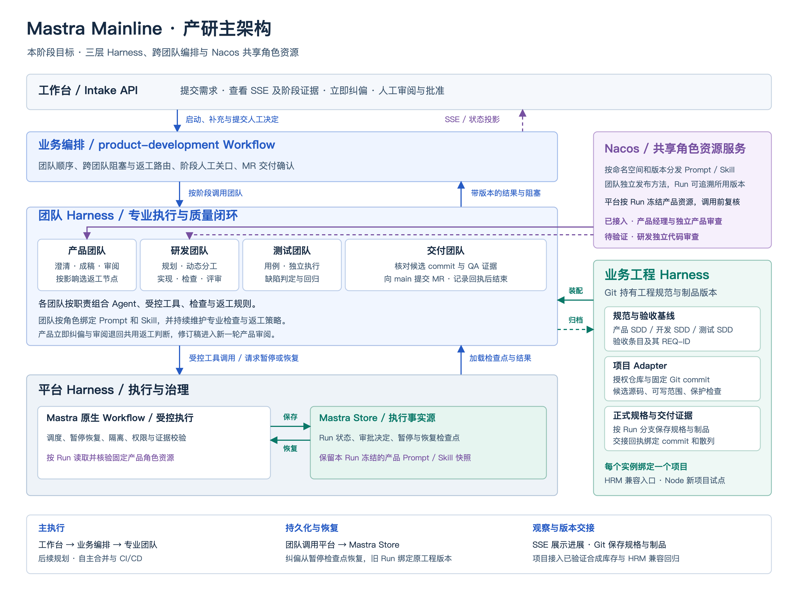
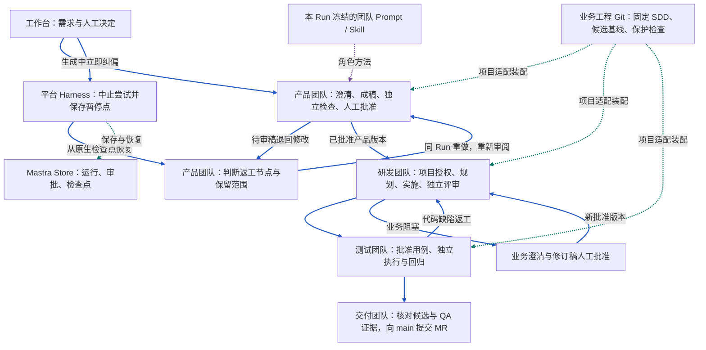
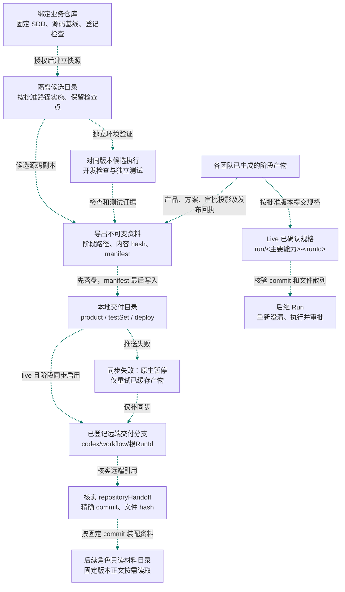
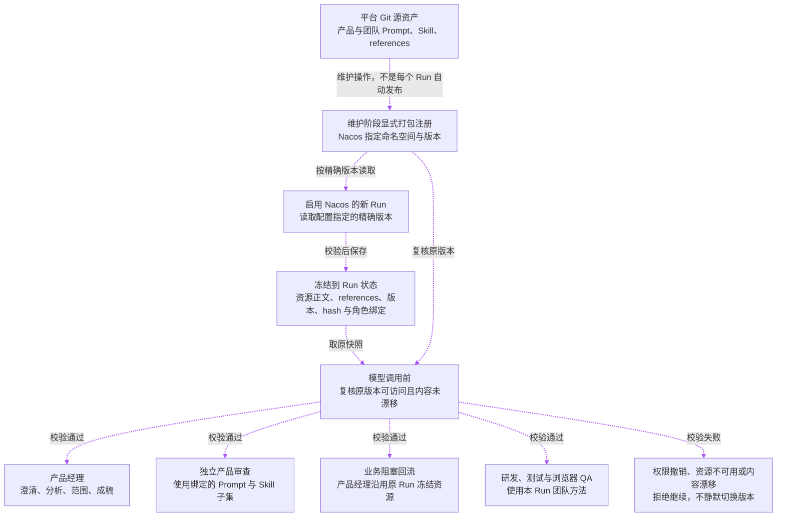

# 产研流程与资源流可视化框架

本页展示 Mastra 主线的跨团队调用、Git 版本交接与 Nacos 资源流。三层职责、源码入口和验证范围见[Harness 架构](./harness-architecture.md)。

## 当前主流程与建设方向

[可编辑 Draw.io 源图](../assets/mastra-mainline-architecture.drawio) · [SVG](../assets/mastra-mainline-architecture.svg) · [PNG](../assets/mastra-mainline-architecture.png)

主图按 2026-11-19 工作区实现核对。工作台提交需求、纠偏和人工决定。主 Workflow 调用各团队，团队通过平台 Harness 执行，并从业务工程 Harness 加载版本化规格与检查。Live 正式规格按 `run/<主要能力>-<runId>` 分支交接，启用阶段同步时，阶段资料走 `codex/workflow/<根RunId>`。合成库存案例验证了工作台入口到交付终态。已授权真实仓库的 MR 交付仍待验收。

主图保留绘制时的产品资源接入示意；当前团队方法接入以本页下方资源流及最新 ADR 为准。Nacos 分发经治理的团队方法版本，Run 的资源快照、执行和审批事实保存在 Mastra Store。

### 产研链路建设建议

保留产品确认、研发授权和独立质量确认。先用真实 HRM 需求核对批准规格、QA 候选与 MR 提交的对应关系。以下合并、构建及预发验证属于后续建设。

| 交接 | 建议建设与验收 |
| --- | --- |
| 需求 → 验收证据 | 稳定 ID、任务与用例关联、结果投影及修订影响已实现，隔离样例已覆盖。真实 HRM 需求的端到端验收待验证。见[需求到验收证据](./unified-workflow.md#需求到验收证据)。 |
| 候选代码 → 合并与构建 | 采用受控 PR。对合并结果复验，记录构建提交与制品 digest，确保进入发布审批的制品能追溯到通过检查的源码。 |
| 制品 → 预发验收 | 按批准的 digest 部署，在预发执行关键业务用例和回滚演练。核对实际运行版本与发布审批、机器回执一致。 |
| 交付 → 上线后反馈 | 记录已发布版本的业务指标与线上问题。由负责人判断是否形成后继 Run，并关联来源规格。 |

正式规格、阶段产物副本和后继 Run 的契约见[当前 OpenSpec](../../openspec/specs/project-mainline/spec.md)。

## 阅读约定

| 线路 | 含义 |
| --- | --- |
| 蓝色实线 | 业务推进、人工关口及返工回流 |
| 绿色虚线 | Git 资料、产物交接与 Store 检查点 |
| 紫色线 | Nacos 资源或 SSE 观察，箭头旁标注用途与接入状态 |

箭头文字同时说明含义，避免仅依赖颜色。主流程按责任团队分组；研发业务阻塞后的澄清归产品团队。为减少交叉线，主图展示数据入口与出口，后两图展开交接细节。Mastra Store 持有执行、审批和恢复事实。Git 持有 SDD、源码基线与交付版本。Nacos 分发版本化团队方法。

## 主流程与数据入口、出口

默认主线为产品 → 研发 → 测试 → 交付。交付团队向 `main` 创建 MR 并记录回执。自主合并和 CI/CD 属于后续规划。

各团队的阶段审阅、立即纠偏、测试返工与交付重试见 [Workflow 执行链路图](./unified-workflow.md#workflow-执行链路图)。

主图压缩了团队内部步骤。产品拒绝/退回、工程准备、模型故障、预算耗尽和发布回滚的完整边界见[完整产研流程](./unified-workflow.md)。业务阻塞回流是原 Run 的专用子流程，不是重新执行首次产品流程的全部节点。工程条件缺失走项目准备与重新确认，不应当作业务问题交给产品修订。

## Git：源码输入、候选实施与资料交接

- 默认 HRM 使用 `product/sources/` 的只读 Workspace。登记项目从固定 Git commit 加载产品、开发、测试 SDD、候选源码、保护检查，以及根目录和候选路径祖先目录中适用的 `AGENTS.md`。项目规则按目录层级冻结为只读 `instructionFiles`，上下文 Agent 的真实读取回执进入 Run 证据；项目授权由服务端核对目录散列。
- 阶段资料使用 `<area>/runs/<根RunId>/<stage>/<hash>/` 保存。产品与研发资料归 `product`，测试归 `testSet`，发布与最终交付归 `deploy`。
- 候选代码通过 `candidate-files.json` 等资料形成交付副本，不自动合入业务源码主分支；实际开发修改发生在隔离候选目录。
- HRM 兼容配置支持按阶段选择远端目标。显式登记项目的阶段同步使用绑定仓库。Live 正式规格沿同一能力命名 Run 分支追加。
- fixture 不推送真实远端。同步成功回执用于固定版本交接；Agent 使用 `handoff_locate` / `handoff_read` 读取已登记材料，不获得任意 Git 操作权限。尚未交付的材料可使用本次调用固定快照。
- Git 档案不是数据库备份。跨机恢复不能只拉取 main 或 Run 分支，还需满足原生 Store、候选目录、恢复缓存与执行身份要求。

## Nacos：源资产、冻结与角色装配

Nacos 更新版本不会自动替换已有 Run 的资源。研发消费自己绑定的方法，而非整套产品 Skill；测试和浏览器 QA 也消费各自方法。旧 Run 或显式关闭 Nacos 的路径保留本地兼容行为；候选导出不等于目标环境已发布或完成生产验收。

## 事实源与能力边界

| 对象 | 负责什么 | 不能据此认定什么 |
| --- | --- | --- |
| Mastra Workflow / Store | 执行、审批、暂停、恢复与 Run 资源快照 | 引擎运行结束不等于业务交付成功 |
| Git 源资产与交付分支 | 资料版本、代码基线、交付副本、固定 commit 交接 | 已合入业务主分支或能跨机恢复 Run |
| Nacos | 经治理团队 Prompt / Skill 的指定版本分发与访问；新 Run 的完整目录来源 | 业务数据、Run/审批事实、工具或仓库/部署权限；目标环境发布与生产治理已完成 |
| 隔离候选目录 | 授权实现、检查与测试的源码版本 | 已部署或已完成业务验收 |
| 发布及健康回执 | 记录外部实际执行结果 | 已接通自动 CI/CD 或机器认证回执 |

目前是受控试点：流程结构和版本化资料交接已有实现，真实业务端到端交付、生产多实例恢复与完整团队定制尚未验收。证据详见 [Nacos live 验证记录](./nacos-live-run-findings.md)与[接入待办](./nacos-integration-todo.md)。

## 实现索引与维护规则

| 图示职责 | 当前实现 |
| --- | --- |
| 业务工程装配 | [project.ts](../../src/business-engineering/project.ts)、[验收需求契约](../../src/business-engineering/acceptance-requirements.ts) |
| 立即纠偏与产品返工 | [平台中止](../../src/mastra/platform/interruptible-attempts.ts)、[产品团队返工判断](../../src/mastra/workflows/product-rework.ts) |
| 主链与初始化资源冻结 | [product-development.ts](../../src/mastra/workflows/product-development.ts) |
| 产品团队、研发团队与业务阻塞回流 | [product-team.ts](../../src/mastra/workflows/product-team.ts)、[development-team.ts](../../src/mastra/workflows/development-team.ts)、[blocker-workflow.ts](../../src/intake/blocker-workflow.ts) |
| 阶段导出与 Git 交接 | [repository-assets.ts](../../src/delivery/repository-assets.ts)、[remote-handoff.ts](../../src/delivery/remote-handoff.ts) |
| 任务材料装配与分段读取 | [task-context.ts](../../src/delivery/task-context.ts) |
| Nacos 版本读取、快照与访问复核 | [nacos-resources.ts](../../src/mastra/nacos-resources.ts) |
| 角色资源与迁移范围 | [资源清单](./agent-resource-inventory.md)、[资源源资产](../../nacos-resources/product/README.md) |

修改行为契约时先更新 OpenSpec，再同步实现和本页。新增或移动流程节点时保留责任团队归属；增加数据线路时说明读写内容、版本绑定与事实所有者。图中每条边按声明顺序从 0 编号，修改边后须同步 `linkStyle` 索引。维护时核对 Mermaid 渲染、相对链接和能力边界，不用预期能力替换已验证事实。

## 仓库资源同步清单

| 资源 | 更新内容 |
| --- | --- |
| [主图资产](../assets/mastra-mainline-architecture.drawio)、[SVG](../assets/mastra-mainline-architecture.svg)、[PNG](../assets/mastra-mainline-architecture.png) | 三层 Harness、跨团队编排、SSE、事实源及版本流共用一张主图 |
| [架构页](./harness-architecture.md)、[绘图规范](../architecture-diagram-style.md) | 统一职责、代码映射、验证范围和主线绘图口径 |
| [根 README](../../README.md)、[文档索引](../README.md)、[协作规则](../../AGENTS.md) | 主入口引用三层 Harness 与跨团队编排 |
| [决策索引](../decisions/README.md)、[三层决策](../decisions/2026-11-19-three-layer-harness.md) | 新记录说明职责演进，历史决策保留当时依据和替代链接 |
| [完整流程](./unified-workflow.md)、[工作台](./guided-intake.md)、[配置索引](../../config/README.md)、[产物数据流](./artifact-dataflow.md) | 对齐同 Run 纠偏与退回、固定 Git 版本装配、HRM 兼容与归档 |
| [主线 OpenSpec](../../openspec/specs/project-mainline/spec.md) | 当前稳定契约已覆盖产品返工、工程绑定与后继 Run，作为图文校验依据 |
