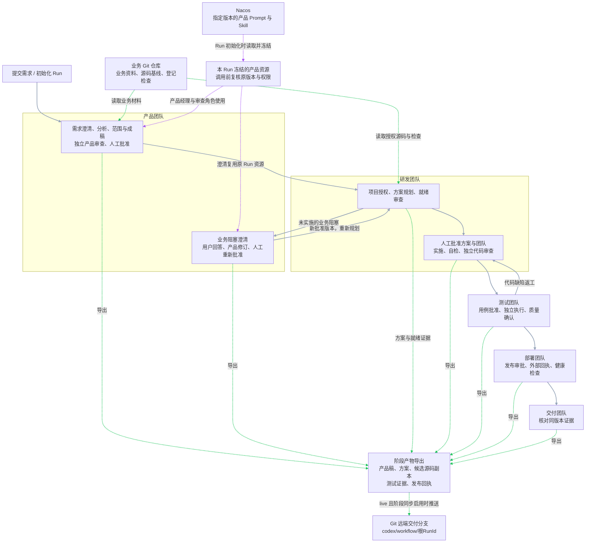
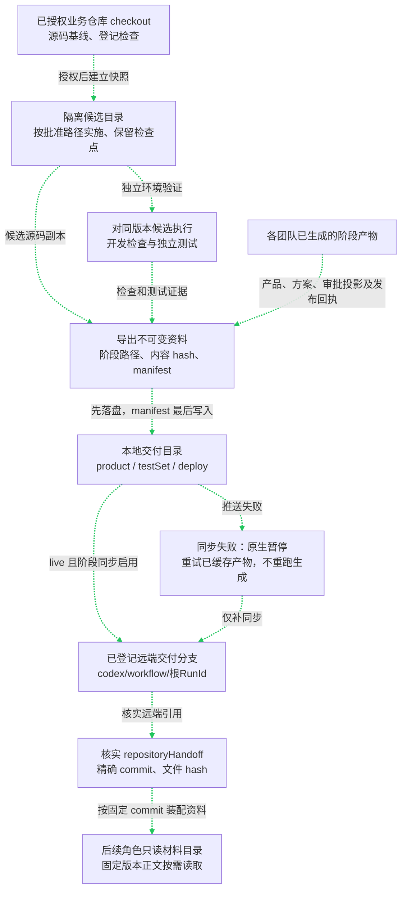
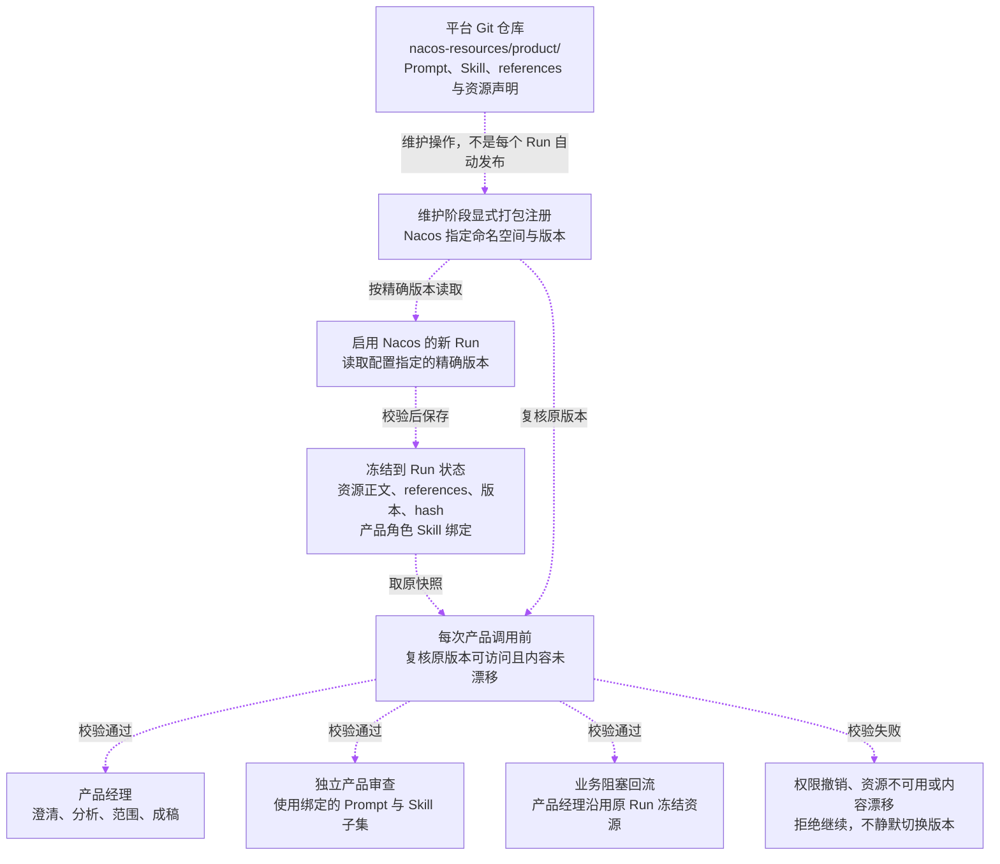

# 产研流程与资源流可视化框架

平台与团队的职责分层见[Harness 架构](./harness-architecture.md)。该页表达已接受的架构方向与待解耦边界；本页继续描述当前运行流程和资源流，两者不可混作实现完成状态。

本页用于查看 Mastra 主线的团队职责、Git 数据交接和 Nacos 资源接入。

## 当前主流程与建设方向

[可编辑 Draw.io 源图](../assets/mastra-mainline-architecture.drawio) · [SVG](../assets/mastra-mainline-architecture.svg) · [PNG](../assets/mastra-mainline-architecture.png)

总图使用 Next AI Draw.io 绘制，以 `f51c6f4` 为核对基线。蓝色实线表示当前主流程和回流。橙色虚线框标出建议补齐的产研交接，以及 H1–H4、资源治理和发布系统接入等支撑能力。参见 [Harness 架构](./harness-architecture.md#演进任务与验收)与 [Nacos 接入待办](./nacos-integration-todo.md)。

- `9ac7668` 纳入正式规格交接及测试、发布业务缺口回流。Live 模式下，人工确认后将规格提交到同一 `run/<主要能力>-<runId>` 分支，下游按固定提交和散列读取。
- `f51c6f4` 加入两条路径。产品人工返工回到同一 Run 的需求澄清。后继 Run 读取已确认并已推送的规格作为只读基线，独立审批。

### 产研链路建设建议

保留产品确认、研发授权、独立质量确认和发布审批。现有规格回执提供版本交接基础。优先选一条边界清晰的真实 HRM 需求，核对从批准版本到预发验证的证据，再用实际交付暴露的问题确定支撑能力的优先级。

| 交接 | 建议建设与验收 |
| --- | --- |
| 需求 → 验收证据 | 稳定 ID、任务与用例关联、结果投影及修订影响已实现，隔离样例已覆盖。图中虚线保留真实 HRM 需求的验收待办。见[需求到验收证据](./unified-workflow.md#需求到验收证据)。 |
| 候选代码 → 合并与构建 | 采用受控 PR。对合并结果复验，记录构建提交与制品 digest，确保进入发布审批的制品能追溯到通过检查的源码。 |
| 制品 → 预发验收 | 按批准的 digest 部署，在预发执行关键业务用例和回滚演练。核对实际运行版本与发布审批、机器回执一致。 |
| 交付 → 上线后反馈 | 记录已发布版本的业务指标与线上问题。由负责人判断是否形成后继 Run，并关联来源规格。 |

下文历史细节图保留 `2434eb5` 的阶段投影视角，其中 `codex/workflow/<根RunId>` 对应阶段产物副本。正式规格与后继 Run 以总图和[当前 OpenSpec](../../openspec/specs/project-mainline/spec.md)为准。

## 阅读约定

| 线路 | 含义 |
| --- | --- |
| 灰色实线 | 业务推进、人工关口及返工回流 |
| 绿色虚线 | Git 资料读取、产物导出与远端交接 |
| 紫色虚线 | Nacos 资源注册、冻结与角色使用 |

箭头文字同时说明含义，避免仅依赖颜色。主流程按责任团队分组；研发业务阻塞后的澄清归产品团队。为减少交叉线，主图展示数据入口与出口，后两图展开交接细节。所有执行、审批和恢复事实归 Mastra Store，Git 文件只是投影，Nacos 提供方法资源。

## 主流程与数据入口、出口

主图压缩了团队内部步骤。产品拒绝/退回、工程准备、模型故障、预算耗尽和发布回滚的完整边界见[完整产研流程](./unified-workflow.md)。业务阻塞回流是原 Run 的专用子流程，不是重新执行首次产品流程的全部节点。工程条件缺失走项目准备与重新确认，不应当作业务问题交给产品修订。

## Git：源码输入、候选实施与资料交接

- 业务材料来自 `product/sources/`，产品角色通过只读 Workspace 按需读取；源码和检查基线在项目授权时由服务端装配。
- 阶段资料使用 `<area>/runs/<根RunId>/<stage>/<hash>/` 保存。产品与研发资料归 `product`，测试归 `testSet`，发布与最终交付归 `deploy`。
- 候选代码通过 `candidate-files.json` 等资料形成交付副本，不自动合入业务源码主分支；实际开发修改发生在隔离候选目录。
- 远端目标按阶段配置；图中的远端分支可以位于不同已登记目标仓库，不表示已支持动态团队按成员分仓。
- fixture 不推送真实远端。同步成功回执用于固定版本交接；Agent 使用 `handoff_locate` / `handoff_read` 读取已登记材料，不获得任意 Git 操作权限。尚未交付的材料可使用本次调用固定快照。
- Git 档案不是数据库备份。跨机恢复不能只拉取 main 或 Run 分支，还需满足原生 Store、候选目录、恢复缓存与执行身份要求。

## Nacos：源资产、冻结与角色装配

Nacos 更新版本不会自动替换已有 Run 的资源。产品审批版本和导出的产品版本资料绑定资源身份；研发消费批准产品结果与审批事实，当前不直接继承整套产品 Skill。阶段、模式和阻塞回流的部分提示词仍在代码内，研发、测试、部署资源也尚未全面迁移到 Nacos。旧 Run 或显式关闭 Nacos 的路径保留本地兼容行为。

## 事实源与能力边界

| 对象 | 负责什么 | 不能据此认定什么 |
| --- | --- | --- |
| Mastra Workflow / Store | 执行、审批、暂停、恢复与 Run 资源快照 | 引擎运行结束不等于业务交付成功 |
| Git 源资产与交付分支 | 资料版本、代码基线、交付副本、固定 commit 交接 | 已合入业务主分支或能跨机恢复 Run |
| Nacos | 指定版本 Prompt / Skill 的分发与访问 | 全部团队已配置化、生产治理已完成 |
| 隔离候选目录 | 授权实现、检查与测试的源码版本 | 已部署或已完成业务验收 |
| 发布及健康回执 | 记录外部实际执行结果 | 已接通自动 CI/CD 或机器认证回执 |

目前是受控试点：流程结构和版本化资料交接已有实现，真实业务端到端交付、生产多实例恢复与完整团队定制尚未验收。证据详见 [Nacos live 验证记录](./nacos-live-run-findings.md)与[接入待办](./nacos-integration-todo.md)。

## 实现索引与维护规则

| 图示职责 | 当前实现 |
| --- | --- |
| 主链与初始化资源冻结 | [product-development.ts](../../src/mastra/workflows/product-development.ts) |
| 产品团队、研发团队与业务阻塞回流 | [product-team.ts](../../src/mastra/workflows/product-team.ts)、[development-team.ts](../../src/mastra/workflows/development-team.ts)、[blocker-workflow.ts](../../src/intake/blocker-workflow.ts) |
| 阶段导出与 Git 交接 | [repository-assets.ts](../../src/delivery/repository-assets.ts)、[remote-handoff.ts](../../src/delivery/remote-handoff.ts) |
| 任务材料装配与分段读取 | [task-context.ts](../../src/delivery/task-context.ts) |
| Nacos 版本读取、快照与访问复核 | [nacos-resources.ts](../../src/mastra/nacos-resources.ts) |
| 角色资源与迁移范围 | [资源清单](./agent-resource-inventory.md)、[资源源资产](../../nacos-resources/product/README.md) |

修改行为契约时先更新 OpenSpec，再同步实现和本页。新增或移动流程节点时保留责任团队归属；增加数据线路时说明读写内容、版本绑定与事实所有者。图中每条边按声明顺序从 0 编号，修改边后须同步 `linkStyle` 索引。维护时核对 Mermaid 渲染、相对链接和能力边界，不用预期能力替换已验证事实。
