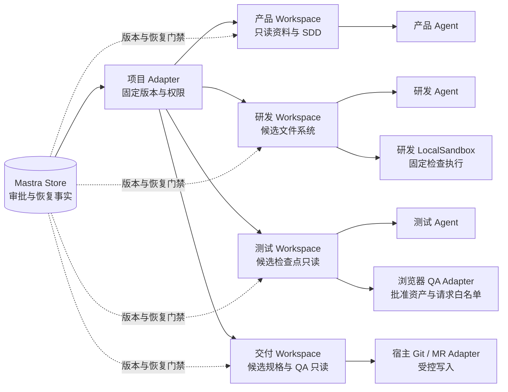
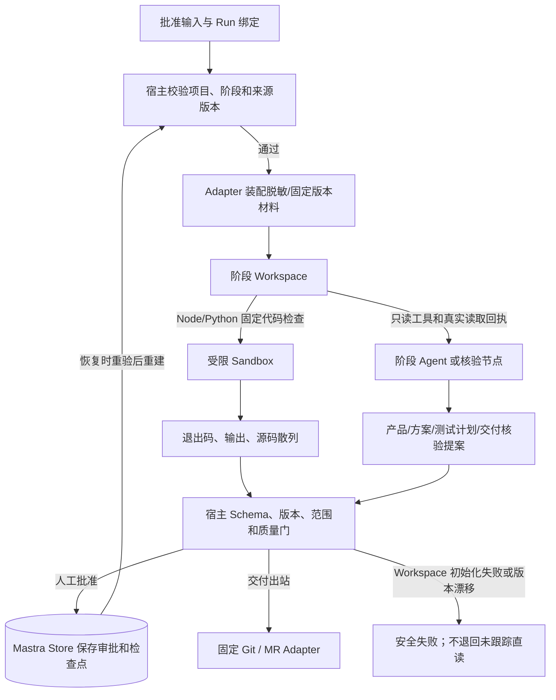

# 全链路 Workspace 改造架构

## 目标和边界

本变更把 Workspace 作为产品、研发、测试和交付 Agent/阶段访问项目材料与候选资产的统一受控入口。Workspace 是阶段运行环境与文件授权边界；它不成为审批、Workflow 检查点或交付状态的事实源。Mastra Store 继续持有运行事实，项目 Adapter 继续持有固定检查和远端写入权限。

产品、评审、测试计划和交付核验使用只读 Workspace，不绑定可执行 Sandbox。研发候选绑定禁网 LocalSandbox；Node/Python 固定检查通过该 Sandbox 执行，HRM/CIP 固定检查仍使用登记的 Docker 验证器。浏览器 QA 使用宿主 Playwright 及受限路由，其候选资源由阶段 Workspace 提供，Playwright 的请求白名单和浏览器策略继续生效。

## 影响范围

| 范围 | 调整 | 保留的事实或权限边界 |
| --- | --- | --- |
| 产品经理、产品审查、需求澄清 | 按 Run/阶段装配已授权资料的只读 Workspace；证据记录实际文件读取 | 产品版本和人工审批仍在 Workflow/Store；Workspace 不开放写入或命令 |
| 研发 | 任务候选 Workspace 及 LocalSandbox；Workspace 只读工具 | 写入仍按任务精确 allowlist；固定 Adapter argv 由宿主调用 |
| 测试计划、浏览器 QA | 测试 Agent 使用当前研发检查点只读视图；浏览器只读取已批准资产 | 自动测试为固定 Adapter 进程证据；浏览器用例、方法和源码版本绑定 |
| 发布/交付 | 只读访问候选、正式规格和 QA 证据 | Git、MR、发布等出站写入由登记宿主 Adapter 执行，模型无写仓库工具 |
| 恢复与审计 | 重建阶段 Workspace 并校验 Run、项目、来源版本和策略身份 | Mastra Store 持有暂停、审批和恢复事实；文件归档仅作投影 |

## 架构图

## 数据流图

## 实施顺序与验收

1. 先实现阶段 Workspace 工厂和来源/策略身份，不改变业务事实 Schema。
2. 产品、测试、浏览器 QA、交付依次接入；每个 Agent 最小化工具，所有读回执从原生工具结果提取。
3. 为来源漂移、跨 Run/项目串读、写入拒绝、命令工具缺失、Sandbox 禁网和原生 Store 恢复增加专项回归。
4. 执行 `npm run check`、相关 Workflow/Adapter 测试及 OpenSpec 校验。真实模型质量、远端仓库与生产部署仍以各自独立证据判断。

## 风险与回滚

- Workspace 工具输出格式或 Mastra 版本升级可能影响读取回执解析；用真实工具结果回归并固定当前依赖版本。
- 产品和测试输入量可能增加；按需文件读取替代整目录注入，并维持现有上下文预算。
- 任一阶段材料身份无法复核时会暂停/失败；修复 Adapter 或重新生成新版本 Run，不静默回退到直读。
- 分阶段发布可回滚到已验证的只读装配；不迁移或删除 Store、仓库、候选和历史档案。

## 当前实施与验证状态（2026-11-22）

本方案尚未完成全链路推广：产品逐项澄清和研发阻塞回流仍使用既有资料入口；产品写作和审查重新装配 Agent 后，既有恢复和中止故障注入回归未通过，需修复后再判定兼容。浏览器 QA 的执行器为宿主 Playwright，交付为确定性核验节点；不能把它们描述为 Sandbox 中的 Agent。

已验证 fixture 统一主链与 Store 恢复、Node/Python 项目路由及 Python 固定检查、只读阶段 Workspace 的隔离与工具边界。HRM/CIP 的 Docker 实际执行、真实模型、真实远端 MR 和生产环境尚未在本次验证。旧挂起 Run 缺少新 Sandbox 策略身份时的恢复兼容性仍需单独验证。
