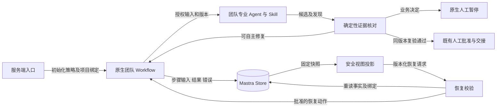

# 跨团队 Run 与恢复方案

## 范围与依据

沿用已接受的三层 Harness 及统一 Team Loop 决策。平台拥有执行治理，团队拥有专业状态及验收，项目 Adapter 装配受控工程事实。Mastra 1.81.0 原生 Workflow、Store、suspend/resume、timeTravel 和 dountil 承载执行。本方案不新增持久化引擎。

## 架构与数据流

## 统一契约与团队归属

| 环节 | 平台职责 | 团队职责 |
| --- | --- | --- |
| Run 策略冻结 | 初始化固定版本、预算维度与项目身份，拒绝未知版本 | 提供受治理的专业策略版本 |
| 原生循环记录 | 在原生步骤状态保存输入版本、候选版本、问题、行动、复验和停止原因 | 给出专业发现、修订及验收证据 |
| 视图投影 | 从 Store 校验并脱敏，不另存恢复事实 | 提供可理解的专业诊断 |
| 安全恢复 | 校验 Run、项目、方法、策略、检查点和请求散列，沿用累计预算 | 判断最早受影响节点和可保留成果 |
| 专业复验 | 校验发现来源、版本和必要回执，执行有界路由 | 核实发现，修订后独立复审，必要时请求业务决定 |

策略按团队及阶段绑定，不统一各团队数值。文档修复、专业返工、网络重试和人工退回分别计量。恢复预算消耗来自原生记录。增加预算须留下显式授权事件或创建带来源的新 Run，不能靠重新进入步骤静默清零。产品文档修复在异常已保存场景恢复历史与候选，并延续累计预算。进程在异常保存前退出的逐轮恢复仍待实现。显式人工退回发起新写作任务时清除上一任务的检查点，保留原步骤事实。

新 Run 保存可解析的策略版本及参数，历史 Run 缺字段走明确的旧策略适配。策略在原生输入创建后保持固定。当前产品实现覆盖主编排及独立入口，其他团队沿用原有预算和状态，待逐项迁移。产品返工由保存的原输入继承策略。

## 审查发现与复验

审查发现应包含稳定 ID、来源产品或候选散列、证据引用、专业类别及影响。结构、引用和回执由宿主检查，业务语义由专业审查判断。声称内容缺失时需要可核实的完整读取证据。资料读取不足先补读，版本不匹配停止，误报保留否决理由。

核实后的发现分别进入自主修订、业务澄清或权限升级。修订产生新的候选版本并再次独立审查。只有对应候选的发现已处置且必要检查通过才进入人工审阅。重复候选、重复未解决发现、预算耗尽分别产生明确停止记录。产品新策略已增加结构化审查、逐项核验、两次自主修订及复审。业务待决项进入人工产品反馈关口，批准被拒绝，需通过既有人工退回明确澄清方向。专业循环目前仍在单步骤内，异常检查点保存已消费修订次数，恢复不会重置；强制进程退出时逐轮恢复待实现。

产品 Skill 负责决定吸收、范围、状态及验收语义。研发 Skill 负责设计、实现和代码质量。测试 Skill 负责覆盖、缺陷及复验。交付策略负责来源、QA、规格和远端回执核验。各团队不得自行扩大执行权限。

## 持久化与兼容

每轮应以原生步骤输出或版本化错误证据保存。长循环采用原生迭代节点逐轮检查点。仅在异常中记录的内部循环不能承诺进程中断前已保存中间轮次。Store 关闭重开的现有测试证明最终错误中记录可读取，逐轮崩溃恢复仍待验证。

视图只读原生快照，校验字段后输出白名单。当前产品逐轮记录投影到现有 attemptDetails，界面已有展示入口。历史错误缺记录时保留可确认的末次错误，不补造轮次。恢复请求从服务端重读原快照，不使用浏览器携带的候选正文或预算。

## 实施顺序与验证

1. 产品先接入策略冻结和失败诊断投影，验证旧策略、新策略、Store 重开及脱敏。
2. 增加原生逐轮检查点与跨恢复累计预算，验证进程中断、重复恢复和版本漂移。
3. 产品审查结构化发现、证据核对、自动修订及复审，验证误报、需要用户决定、无进展和预算耗尽。
4. 研发、测试、交付按现有专业状态适配共同语义，保留原检查、批准和回执边界。
5. 用 HRM 隔离 live 输入逐团队复验，分别记录模型质量、真实检查和人工关口结果。

问题经验检索可由原生事实派生，必须携带来源 Run、项目、版本、解决证据和适用范围。跨项目复用需要明确授权和适用性核对，经验不能直接改变冻结策略或已确认规则。

## 本次适配状态

研发 `InputV2` 保存团队策略并沿既有调用、返工和验证账本执行。测试从相同输入读取策略，检查运行继续计入原验证预算。交付沿用显式暂停恢复，新增带候选及 QA 散列的尝试记录，暂停载荷保存累计尝试。服务端 `teamRuns` 输出各团队实际策略和计量，产品 `qualityReview` 输出当前版本的发现和核验依据，界面接入仍待验证。

审查专业方法新增受治理 Prompt 槽位，候选准备及冻结目录测试须覆盖新增资源。历史方法目录没有质量策略时继续原自由文本审查，不从本地方法回填冻结目录。真实 Nacos 发布及真实模型质量单独验收。
