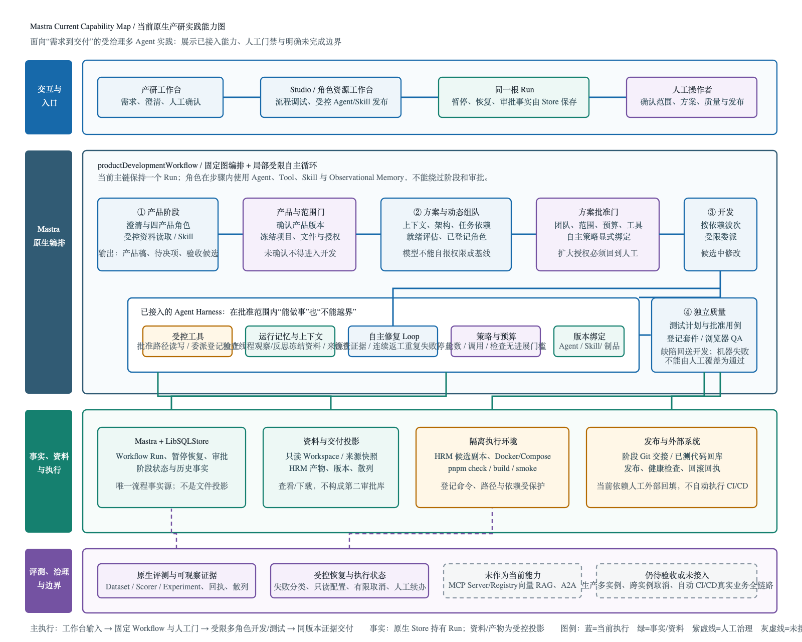

# Mastra 原生应用实践

角色资源已接入正式主流程：Mastra保存Agent/Skill版本，应用负责Run绑定、恢复装配、受控工作台发布、冻结预算/资料副本及可信制品核验。见[配置、发布与恢复](./config/stored-role-runtime.md)及[前置隔离实验](./evaluations/native/stored-role-validation.md)。历史Run不兼容；live主流程需要部署侧可信签名。

主流程同时固定`Run / Artifact / Evidence / Approval / CapabilityGrant / TaskPlan`六类治理记录：Agent输出以带schema、hash和证据引用的Artifact交接；项目范围确认由宿主生成冻结能力授权，架构任务只能在其中选择角色、路径和登记检查，不能由模型扩大。详见[运行资源契约](./config/runtime-resource-contract.md#51-run治理记录与能力授权)。

工作台将原生暂停和已保存执行事实投影为`HumanGate / ApprovalReceipt / AgentInvocation / EvidenceRecord / AgentRun`：它们统一展示关口、调用可见范围、检查/回执证据和Run摘要，但不创建第二状态库，也不能作为恢复输入。任务级或调用级授权、授权撤销/过期、外部写操作和跨实例执行仍是触发式后续决策。

后续改造设计：[以业务验收为完成条件](./business-delivery-design.md)，覆盖澄清续办、最终包审查、纵向旅程及全栈测试；目前为设计稿，以下运行方式与现有能力不因该文档改变。

本机闭环验证示例：[工单标题校验页](./examples/local-delivery/README.md)，运行 `npm run example:local-delivery`，实际执行沙箱测试、浏览器 QA、本机静态发布、健康检查和回滚；角色使用固定模型，自动决策仅为示例策略，不代表真实业务或生产验收。

本实践使用 Mastra 原生 Agent、Workflow 和 LibSQLStore，独立管理入口、依赖和数据，不导入探索主线 Runtime、Store 或 GatewayClient。



[可编辑 SVG：Mastra 当前原生产研实践能力图](../../docs/assets/mastra-current-capability-map-v1.svg)。图将当前接入能力、受限/人工门禁与未接入或待验收能力分开标注；不将 MCP、向量 RAG、生产多实例或自动 CI/CD 表述为当前能力。

长时间执行：见[实际配置说明](./config/README.md#超时与重试的实际配置)及[处理交互设计](./execution-status-interaction.md)。已接入产品生成尝试、失败来源、服务端计时、只读有效配置及二次确认取消。取消仅支持当前服务进程中的需求分析和四产品角色；开发、推送、发布及跨实例取消暂不支持，参数在线调整尚未接入。

## 当前入口与流程

日常操作使用[产研工作台](http://127.0.0.1:4112/)：创建需求、回答澄清问题、阅读完整产品稿，并继续完成项目范围、开发方案、测试与发布回执等人工确认；侧栏“角色资源工作台”可发布受控的新Agent版本。流程在同一个 `productDevelopmentWorkflow` Run 内推进，暂停与恢复事实由 Mastra Store 保存。

需求输入与澄清 → 四产品角色成稿 → 产品确认 → 项目范围授权 → 上下文、架构、动态组队与就绪评估 → 方案批准 → 按依赖开发 → 自检与独立评审 → 独立测试与缺陷返工 → 发布审批、外部执行回执与健康检查/回滚 → 最终交付。

新工作台输入显式批准自主开发策略：团队可在候选内运行登记检查、携带失败证据连续排障，多角色缺陷联合修复并重跑下游。默认3轮返工、72次开发模型调用、24次检查套件执行，连续2次重复失败且无新证据时停止；新增业务决定、扩大授权或预算耗尽升级人工。旧输入保持原政策。原生 Workflow 与真实隔离检查回归已验证，真实模型完整业务交付尚未验收。详见[自主开发与排障](./unified-workflow.md#批准范围内自主开发与排障)及[决策记录](../../docs/decisions/2026-11-09-mastra-autonomous-development.md)。

- [完整产研流程](./unified-workflow.md)：阶段职责、暂停恢复、输入格式和终态。
- [工作台输入与人工关口](./guided-intake.md)：澄清、版本确认、后续表单与校验。
- [产物归档与数据流转](./artifact-dataflow.md)：项目/迭代/Run 关联、历史版本及下载；[产物查看页](http://127.0.0.1:4111/delivery-assets)只读。
- [Studio 流程图](http://127.0.0.1:4111/workflows/productDevelopmentWorkflow/graph)：技术调试与流程检查；日常人工确认可在工作台完成。

开发角色的单模型步骤时限为10分钟，每次 Agent 执行总时限为30分钟（`development-timeout.v3`），不把整个开发阶段或人工等待限制为30分钟。临时模型故障每轮最多5次尝试（含首次），退避后仍失败则原阶段暂停，可多轮人工继续；累计调用额度用完后可在前端填写追加次数，计数不清零。资料不再设置累计读取、初始目录或模型请求体字节门槛，也不要求资料升档确认。live 角色显式启用 Mastra 原生 Observational Memory，按执行独立线程观察和反思工具历史；原生压缩失败仍走检查点恢复。每次失败保存来源、实际触发时限、耗时、UTC时间与调用序号。历史未采集的细项不补猜；已有失败架构节点通过检查点/身份校验后可受控恢复，不跳过方案批准。

## 运行档案

新主流程自动将开始、归档阶段返回、暂停、失败和完成的观察记录保存到 HRM 的 product/catalog/runs/<RunId>/history/。Studio Workspace 中选择“HRM · 运行档案（状态投影，不可恢复）”查看。live 沿用产品阶段开关同步到 Run 交接分支；同步失败保留本地文件，可用 npm run run:archive -- sync <RunId> 补推。档案不迁移执行状态或填充另一台机器的 Recent runs。详见[运行档案说明](./artifact-dataflow.md#2026-11-09项目运行档案)。

## 角色资料交接

绑定仓库的 live 主流程在角色交付时自动提交并推送 `codex/workflow/<根RunId>`，成功回执绑定 commit 与文件散列。开发完成且自检通过后，候选业务源码先提交到该分支，并以 `candidate.json` 与 `status=candidate` 明示待测试；独立测试只为同一 commit 绑定质量回执。发布与健康检查成功后，流程暂停等待人工在外部 Git 平台创建、审批并合并到 `main` 的 PR 回执；该回执还记录审批人、merge commit 与合并后 main HEAD。Workflow 不持有凭据，也不会自动创建 PR 或写入 `main`。工作台从同一 Run 的 Lifecycle 投影展示分支、候选 commit、质量、发布、PR 与合并版本，不另建交付状态库。推送失败在工作台暂停，可仅重试同步而不重新生成；fixture 不推送真实远端。“项目仓库管理”登记并校验本机项目 checkout，“远端同步设置”再为产品、技术方案、开发与评审、测试、发布五个阶段分别启停同步并选择已登记仓库；默认全部使用 HRM。管理页不接受凭据，保存时服务端核对 Git 根目录与 HTTPS origin；`MASTRA_REMOTE_SYNC_TARGETS` 仍可作为首次启动的初始字典。设置只作用于后续进入的节点，不改写已保存的 Run、审批或交接回执。当前路由粒度是阶段；要按前端/后端等动态开发角色拆仓，需要先让角色任务形成独立交付节点与路由键，不能仅靠页面配置假装已经隔离。Agent 默认接收任务和资料目录，按需分段读取固定版本原文，并由 Mastra 原生观察记忆管理执行中的上下文。历史审批与恢复快照仍兼容保留。详见[远端交接说明](./artifact-dataflow.md#2026-11-08远端交接与按需上下文)。

## 原生上下文管理

`@mastra/memory@1.41.0` 与 `@mastra/core@1.81.0` 配合，由统一工厂装配产品、开发v2、独立测试和部署角色。观察器和反思器使用当前角色同一模型及出口，不自动切换服务商。每次调用/重试使用独立线程；默认在估算的 24000 消息 token 触发同步观察、12000 观察 token 触发反思。这些是内部压缩阈值，不是资料容量或人工审批门槛；provider 溢出时启用原生观察后重试。

资料仍按固定版本分页读取，单次返回有界、累计不限。压缩属于有损模型操作，会产生额外调用，不能保证任意模型窗口或业务事实零遗漏；原文可以重新读取，审批只认 Workflow 的保存事实。历史资料预算失败可直接从原检查点继续，无需升档。真实长资料任务的质量与成本仍需验证。

## 启动

使用 Node.js 24+，在本实践目录安装依赖。后端与前端分别保持一个终端运行；同一项目目录只启动一个 Mastra dev 实例。

```bash
cd /Users/lei/code/ai-platform/practices/mastra
npm ci --ignore-scripts --no-audit --no-fund
npm --prefix web ci --ignore-scripts --no-audit --no-fund

# 终端一：默认真实模型模式，使用独立数据目录。
MASTRA_MODE=live MASTRA_DATA_DIR=.data/live npm run dev

# 终端二：启动产研工作台。
npm run review:dev
```

打开工作台，填写需求与迭代标识。页面默认开启需求澄清；fixture 使用固定响应，只能验证控制流，不理解业务输入。阅读和恢复已有 Run 时，后端必须使用创建时的模式与数据目录。前端代理固定连接 `127.0.0.1:4111`。

如需离线验证控制流，必须显式指定 `MASTRA_MODE=fixture` 并使用独立数据目录，例如 `MASTRA_MODE=fixture MASTRA_DATA_DIR=.data/fixture npm run dev`；该模式不应作为日常产研入口。

## 配置真实模型

只使用本实践自己的 `.env`，按下表设置模型配置，不要复制根目录密钥。进程环境变量优先。

| 配置 | 默认 / 要求 |
| --- | --- |
| `MASTRA_MODE` | `live`；显式设置 `fixture` 仅用于离线控制流验证 |
| `OPENAI_API_KEY` | live 必填 |
| `MASTRA_MODEL` | 真实模式必填；未匹配角色的默认模型，参见 `.env.example` |
| `MASTRA_BASE_URL` | 可选 OpenAI-compatible API 基址 |
| `MASTRA_PORT` | `4111`；修改后需同步前端代理 |
| `MASTRA_DATA_DIR` | `.data/live`，相对本实践根目录，也可为绝对路径；fixture 请使用独立目录 |
| `MASTRA_HRM_REPOSITORY` | 可选 HRM checkout 绝对路径；默认同级 `hrm`，origin 必须匹配 `leidaibo-lab/hrm` |
| `MASTRA_REMOTE_SYNC_TARGETS` | 可选 JSON 数组，登记额外目标：`id`、`label`、`root`、`origin`；服务重启后在“远端同步设置”选择 |

配置真实模型后，先运行 `npm run smoke:live` 检查终答与实际工具调用，再启动后端：

```bash
MASTRA_MODE=live MASTRA_DATA_DIR=.data/live npm run dev
```

真实模式会产生模型调用费用。前端不持有模型密钥。服务仅供本机使用；审阅人和操作者是本地声明标签，尚未接入账号认证或多人权限隔离。

## 当前执行边界

HRM 项目由服务端自动关联当前仓库、分支和版本。用户确认项目后，开发 Agent 根据需求决定具体改动路径和团队，方案批准后才实施。HRM 候选通过 Docker/Compose 执行完整的 `pnpm check`、`pnpm build` 和 `pnpm smoke`，数据库为独立临时实例；检查脚本、依赖清单和锁文件受保护。旧 Node fixture 执行器保留兼容。

只有产品资料、尚未建立工程骨架的仓库也可先交接生成方案。工作台逐项列出工程文件、固定脚本及 Docker 的准备缺口；这些缺口随本次输入保存，存在时仅允许只读规划，不能批准实施或执行检查。工程准备完成后，使用“重新检查项目，继续交接”返回同一 Run 的项目确认关口；保留产品批准，重新确认当前仓库版本后再规划。不会自动创建工程骨架。

可在本目录运行 `npm run verify:hrm -- /Users/lei/code/hrm` 重新验证当前基线，要求 Docker Desktop 可用。结果保存到忽略的 `.data/hrm-verification-result.json`。2026-11-08 三项真实基线检查通过；这不代表招聘业务已实现或全部业务验收通过。研发交付和自检通过后，`publish-tested-code` 将批准任务内的候选源码提交到 `codex/workflow/<根RunId>`；独立测试通过后只为同一 commit 绑定质量散列，随后才进入发布计划。发布/健康通过后必须由人工 PR 回执确认合并 main；项目确认冻结 Git 基线，拒绝未提交的源码/工程配置混入、目标分支漂移及缺少基线的历史 Run。回执保存 commit、源码/质量散列，失败只重试同步。真实 bare 远端与跨 Store 恢复已验证，GitHub push dry-run通过；真实业务 Run 的 HRM 实际源码推送、PR 与合并仍待验收，CI 制品绑定尚未接通。独立测试会重跑登记套件，人工用例需要实际结果和证据。

部署由外部平台实际执行，工作台收集发布、健康检查与回滚回执，尚未接入自动 CI/CD。最终交付依赖同版本质量与发布证据；人工回执不等于机器独立验证。真实业务全链路、生产多实例和完整故障恢复尚未验收。

HRM 的 `product/sources/` 为产品资料来源；阶段投影分别归档到 `product/`、`testSet/`、`deploy/`。归档文件只供查看，审批和恢复以 Mastra Store 为准。

## 维护与评测

```bash
npm run check
npm run review:build
npm test
npm run smoke
npm run build
```

这些是可执行的检查命令，不表示本次文档整理重新运行了它们。测试数量和具体通过结果以对应验证记录为准，固定模型控制流、真实模型质量与实际工程交付分别记录。

- [可靠性回归与架构续验](./evaluations/reliability/2026-11-07.md)
- [需求工作台验证证据](./guided-intake.md)
- [原生节点评测](./evaluations/native/README.md)、[开发角色评测](./evaluations/native/development-nodes/README.md)、[独立评审与返工](./evaluations/native/review-rework/README.md)
- [产品 Skill 配对评测](./evaluations/product-skills/README.md)、[招聘管理验证项目](./projects/pm-hrm-recruitment/README.md)
- [资源配置归属](./config/README.md)与[资源输入契约](./config/runtime-resource-contract.md)：已落地预算、资料副本和开发调用信封；13种严格角色DTO及完整验收矩阵仍在后续迭代。
- [产品角色与 Skill](./src/mastra/agents/product-roles.ts)、[PM 技能套件](./.agents/skills/README.md)、[第三方声明](./web/THIRD_PARTY_NOTICES.md)

Mastra 提供 Agent、工具循环、Workflow 与存储；本实践维护业务 schema、版本绑定、人工关口、权限边界和 I/O 适配。不将文件投影另建为审批库，不以评测计数替代业务质量验收。

## 历史与兼容资料

旧四阶段提案链、独立产品/开发 CLI 和旧审阅页的启动、测试计数及阶段观察移至[历史记录](./README-history-2026-11-07.md)。这些资料用于追溯旧 Run，不作为当前操作步骤。

[旧审阅页](./review-page.md)、[独立开发设计](./development-workflow-design.md)和[BMAD 双流程设计](./bmad-workflow-integration.md)保留版本边界；当前操作统一以上文工作台与完整产研流程为准。

### 按角色配置模型

模型选择集中在本实践 `.env`，示例见 [.env.example](./.env.example)：

```dotenv
MASTRA_MODEL=openai/gpt-5.6-sol
MASTRA_PRODUCT_MODEL=openai/gpt-6-luna
MASTRA_DEVELOPMENT_MODEL=openai/gpt-5.6-luna
```

复用 Mastra 原生 Agent 的 model 配置。产品四角色使用产品覆盖；开发提案及开发 v1/v2 全部角色（含评审和受限委派）使用开发覆盖；其他角色和评测裁判使用默认模型。角色变量缺省或为空时回退 `MASTRA_MODEL`。真实模式要求显式设置默认模型；fixture 缺少默认配置时仅使用模拟模型占位标识。代码不内置上述业务模型名称，端点和凭据沿用原配置。

重启实践服务后生效。开发恢复身份记录实际开发模型，切换开发模型后旧 Run 的身份校验可能拒绝继续，应使用新 Run。模型可用性与真实质量仍需上游验证。

浏览器 QA 已接入主 Workflow：在测试用例批准关口显式选择 browser，执行真实 Chromium 并在质量关口查看截图与版本绑定回执。安装、示例与边界见[浏览器 QA](./browser-qa.md)；首版限候选静态 HTML，HRM 全栈需后续启动 Adapter。

本轮独立角色评测与源码回库证据见[2026-11-09报告](./evaluations/native/development-nodes/results-2026-11-09.md)；源码回库边界见[决策](../../docs/decisions/2026-11-09-mastra-code-publication.md)。
