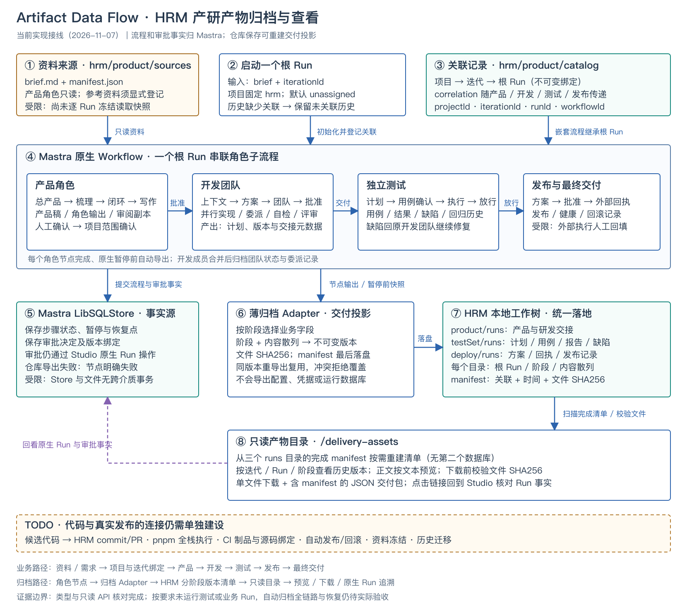

# HRM 产物归档、查看与数据流转

2026-11-07：接通完整产研 Workflow 的项目、迭代、根 Run 与分阶段产物。采用现有 Mastra 原生步骤和 API route，适配不可变文件清单；不新增依赖、服务或审批库。选型及未采用方案见[决策记录](../../docs/decisions/2026-11-07-hrm-asset-catalog.md)。

本地查看入口：<http://127.0.0.1:4111/delivery-assets>。同一个 Studio 服务提供页面与接口；先启动本实践 `npm run dev`。页面按项目、迭代、Run、阶段筛选，可查看阶段历史版本、预览纯文本、下载单文件或含清单的 JSON 包。本产物查看页只读；人工决定在[产研工作台](http://127.0.0.1:4112/)提交，也可链接回 Studio 原生 Run 调试流程事实。当前历史 Run 尚未迁移，因此初始空态是真实状态。



[可编辑 SVG](../../docs/assets/mastra-hrm-artifact-dataflow.svg) · [PNG](../../docs/assets/mastra-hrm-artifact-dataflow.png)。图中当前接线、受限能力及 TODO 分开标注；代码与自动部署接线尚未完成。

## 一次迭代如何贯穿

在 `productDevelopmentWorkflow` 的新 Run 输入：

```json
{
  "iterationId": "recruitment-001",
  "brief": "填写本次真实需求、目标、范围与验收预期"
}
```

项目固定为 `hrm`，迭代 ID 支持英文字母、数字、下划线和短横线，最长100字符，首字符为字母或数字。未提供时由服务端使用 `unassigned`（未指定业务迭代）；Studio schema 表单可能把默认字段显示为必填，保留默认值即可。Run ID 由 Mastra 提供，客户端不能通过输入声明批准状态或更换归属。

初始化把 `{projectId,iterationId,runId,workflowId}` 保存到产品状态，项目授权时传给开发输入，后续测试、发布使用同一根 Run 关联。内部嵌套 Workflow 不会覆盖根 Run。相同 Run 的迭代或原始需求发生漂移时拒绝覆盖；多个 Run 可以属于同一迭代。`project.id` 仍是开发输入清单中的执行项目标识，不用它替代资产项目 `hrm`。

```text
hrm/
  product/
    sources/brief.md、manifest.json          资料来源
    catalog/
      projects/hrm/project.json             项目登记
      projects/hrm/iterations/<id>/iteration.json
      runs/<rootRunId>/run.json              不可变归属及初始 briefHash
    runs/<rootRunId>/<stage>/<hash>/         产品与研发交接
  testSet/runs/<rootRunId>/<stage>/<hash>/    测试产物
  deploy/runs/<rootRunId>/<stage>/<hash>/     发布产物
```

`catalog` 只保存项目/迭代/Run 关联，不保存流程状态；统一产物清单按需从三个目录的完成 `manifest.json` 重建。没有全局共享可变索引，避免并行 Run 竞争覆盖列表。目录和 JSON 包都是文件投影，不构成新的审批事实源。

## 各角色归档什么

| 角色或关口 | 自动归档的交付副本 | 目录 |
| --- | --- | --- |
| 初始化、四个产品角色及成稿 | 原始需求、每个角色正文、产品版本与来源观察清单 | product/runs |
| 产品确认、项目范围确认 | 审阅决定投影、产品版本、精确文件授权范围（不复制全套源码） | product/runs |
| 上下文、方案、团队、就绪、批准 | 需求锚点、上下文、任务/团队、批准版本和评估副本 | product/runs |
| 并行成员合并、自检、评审、交付、恢复关口 | 任务/委派记录、源码检查点、检查/评审和研发交接元数据 | product/runs |
| 测试计划、用例确认、执行、质量确认、返工路由 | 测试计划、结构化用例、检查与结果、缺陷、历轮质量记录 | testSet/runs |
| 发布计划、范围确认、外部执行、健康、回滚、最终交付 | 方案、范围、版本绑定、外部回执、最终结果及质量来源 | deploy/runs |

开发成员分支在原生 foreach 中持久化，合并节点形成可归档的完整开发状态；不为每个临时分支新增独立项目或审批记录。未执行、仅透传的节点可能导出同状态阶段快照，因此阶段 `completed` 表示节点返回，不代表该业务阶段通过。产物内的业务 outcome、质量及发布状态和原生 Run 事实需要一起看。

## 归档时机与版本含义

- 节点成功返回后归档明确选择的业务字段；原生暂停前归档当前输入，标记 `pending`。人工批准、退回或停止后的输出标记 `completed`。
- 版本目录由关联与导出内容散列确定；时间不参与散列。同节点、同内容重导出复用已有版本；业务字段变化或 `pending/completed` 变化产生新版本。
- manifest v2 保存根 Run、阶段、模式、事件、创建时间、correlation、投影散列及每个文件的 SHA256。业务产品 hash、源码 checkpoint、质量 hash 和发布 hash 保存在各自 JSON 中，分别表达不同版本边界。
- 文件先写，manifest 最后写，未完成目录不进入目录清单。同版本冲突拒绝覆盖；导出失败使节点明确失败。文件系统与 Mastra Store 没有跨介质事务，需通过原生失败节点恢复；完整中断恢复仍待真实 Run 验收。
- 旧 manifest v1 仍可列出，无关联或创建时间时明确显示“未关联历史/旧版未记录”。不会根据目录时间猜迭代、批准或业务版本；旧 `.data` 不自动迁移。

文本预览及下载只接受清单 ID 和已登记文件名；拒绝路径穿越、符号链接、未知文件及散列不匹配。正文用 `textContent` 展示，不执行 HTML/脚本。SHA256 是内容完整性检查，不是签名，也不是用户身份或批准证明。单文件上限8MiB、JSON 包正文合计64MiB，目录扫描上限25,000项、关联 Run 上限5,000；超过后明确失败，应升级分页索引/对象存储，不静默省略。

## 本地只读接口

Mastra 自定义路由挂在服务根路径，**不带 `/api` 前缀**。

| GET 路径 | 用途 |
| --- | --- |
| `/delivery-assets` | 只读页面 |
| `/delivery-assets/catalog` | 项目/Run 关联与统一阶段版本清单 |
| `/delivery-assets/file?id=<清单ID>&name=<文件名>` | 校验后返回纯文本 |
| `/delivery-assets/file?id=<清单ID>&name=<文件名>&download=1` | 单文件下载 |
| `/delivery-assets/bundle` | 含 manifest 与文件正文的 JSON 交付包 |

catalog 和 bundle 支持 `projectId=hrm`、`iterationId`、`runId`、`stage` 筛选。目录不复制原生 Store 或模型配置；接口无写入/审批操作，本地服务继续绑定127.0.0.1。非法参数返回400，未知产物/文件返回404，读取或完整性异常返回409，交付包超限返回413。

## 资料来源、代码和上线的边界

产品角色从 HRM 的 `product/sources` 读取真实材料。`sources-observed-at-export.json` 只说明导出时看见的来源清单；逐 Run 冻结资料和工具实际引用校验待建设，不能声称生成时读过清单全部资料。

代码目标为确认的 HRM 工程仓库。当前隔离候选已支持全栈执行；独立测试通过后，`publish-tested-code` 使用临时 Git index 将批准任务的新增/修改源码写到真实路径并推送 `codex/workflow/<根RunId>`，不修改用户 checkout/index。代码回执存入 Lifecycle 的 `codePublication`，阶段 `source.json` 也投影基线、源码/质量散列和远端 commit；后续发布只消费同版本回执。资料仍放在 product/testSet/deploy，`candidate-files.json` 是历史/取证副本。删除、自动合并、PR 和 CI 制品绑定尚未接通；真实业务远端推送待验收，详见[源码回库决策](../../docs/decisions/2026-11-09-mastra-code-publication.md)。

发布节点保存批准范围和人工回填的外部执行、健康、回滚结果。本轮没有运行实际部署，也没有接入自动 CI/CD 或认证审批身份。大型附件、备份保留、多用户权限和历史补归档需后续建设。

## 实现与本轮证据

Zod 校验 `AssetCorrelation`、Run 记录、manifest 与 URL 参数；关联为不可变记录，阶段产物为内容版本。`withRepositoryAssets` 使用装饰器模式附加导出，执行与审批仍由原生步骤拥有；文件 Adapter 负责路径/完整性边界，catalog 只重建目录，HTTP 层只处理查询与文本响应。按单一职责拆分，复用原生框架，不建设新运行时或数据库索引。

TypeScript 检查通过；运行中的 dev 服务返回页面、真实空目录及 JSON 包200，非法文件参数400，未知文件404。Workflow 只读定义确认存在 iterationId、产品、开发、测试及发布主链；SVG 渲染 PNG 并视觉核对。按用户要求未新增或运行测试、模型业务 Run 或部署，因此“新 Run 各阶段实际落盘、断点恢复、并发与有内容的下载”仍待用户介入验收，未用伪造产物填充页面。浏览器交互未验收，HTTP 检查与图像核对单独报告。

## 2026-11-08：远端交接与按需上下文

以下规则替代上文“只在本地归档、不产生提交”的旧边界。完整产研入口绑定 HRM 仓库且运行于 `live` 模式时，阶段产物自动提交并推送到 `codex/workflow/<根RunId>`；fixture 仍只做本地投影，避免合成资料进入真实远端。无需新增模型凭据或依赖，Git 使用宿主既有认证，origin 仍必须为授权 HRM 地址，pushurl 不得指向其他地址。

宿主使用临时 Git index 与 commit-tree，只将本阶段明确选择的资产文件加入提交，不切换工作树、不处理用户暂存区、不自动合入 main。远端提交保留原有 `product/testSet/deploy/runs` 结构；`candidate-files.json` 保存开发步骤实际候选源码与检查点，用于交付审查，不等于将代码合入 apps 目录。澄清建议、人工答案、返工来源和产品修订也保存对应 JSON。并行成员的源码在合并屏障后形成完整候选版本，再作为下一角色的输入。

步骤成功结果先原子写入 `.git/workflow-handoffs` 私有恢复检查点，再导出并推送。远端提交成功且核实远端引用后，Workflow 输出 `repositoryHandoff`，记录 schema 版本、分支、精确 commit 和本阶段文件 SHA256。相同投影重试复用原提交；已推进到后继提交时不会回退分支。不同 Run 各用自己的分支，不强推。

同步失败通过原生 `suspend/resume` 暂停，在工作台显示“重试角色资料远端同步”。重试仅同步已缓存产物，不重新运行角色、不重复修改候选，也不替代原来的业务审批；同步成功后回到原流程。恢复缓存必须与本 Run、步骤和输入散列一致，缺失时拒绝重新生成冒充恢复。私有缓存不是跨机器备份，迁移运行环境需同时保留 Mastra 数据、候选目录和该缓存。外部人员改写同一 Run 分支产生分叉时，普通 push 拒绝覆盖，需要维护者核对并处理该分支。

角色运行时，完整正文不再默认全部展开到 prompt。产品、开发、测试、发布及澄清模型调用按本次任务构造只读资料目录；超过3000字节的字段折叠为带 SHA256、语义路径、长度和开头摘录的引用。摘录明确不是业务摘要。已保存的远端回执可提供固定 commit 文档读取；当前候选等尚未交付的材料使用本调用固定快照。Agent 无 Git 或任意文件权限。

原生 `handoff_read` 工具按登记 ID、offset、length 分段读取，单次最多6000字符；累计读取、初始目录总量及provider消息字节不设业务门槛。live角色显式启用 Mastra Observational Memory：每次执行独立线程，按token估算触发同步观察及反思，历史原始消息仍归Mastra Store保存。provider上下文溢出启用原生观察后重试；旧资料预算故障无需升档即可从检查点继续。观察/反思使用角色同一模型和出口，会增加调用并可能丢失细节，原文可重新读取，真实质量和成本仍待专项验收。

历史正文、批准依据和基线文件仍由旧 schema 保留兼容快照，确保原生审批与源码恢复不失效；新增候选正文只用于导出，不保留在业务状态中。当前完成“版本回执 + 按任务组装模型输入”，未进行整个历史 Workflow 状态仅引用化迁移。独立 CLI 未设置仓库时保留原有边界，已有历史 Run 不自动补推或迁移。

实现采用 Git Adapter、Step Decorator 和按调用只读工具；Git 管版本与网络，Mastra 管暂停/恢复及审批。没有自建版本引擎、调度器或摘要模型。验证使用临时 bare 远端与框架模型测试端口，不向真实 HRM 远端写入合成材料，也不代表真实模型业务质量通过。

## 2026-11-09：项目运行档案

新主流程开始业务执行、已接入归档的阶段返回/暂停/失败及根 Run 暂停/失败/完成时，宿主自动写入 product/catalog/runs/<根RunId>/history/<UTC时间>-<UUID>.json。run.json 继续保存不可变归属，history 保存追加的版本化观察，不覆盖旧事件。仅 createRun 尚未 start 的空记录不生成业务档案；旧 Run 不自动补造历史。

记录包含 run-archive.v1、项目/迭代、Run ID、Workflow 注册 ID 与定义 ID、档案契约版本、scope（run/step）、阶段、状态、脱敏原因类别、UTC 观察时间、平台代码 commit 与 dirty 标识、已完成产物清单路径、已有远端交接回执和恢复条件。workflowVersion 是本次档案接入版本，精确实现由 code.revision 和 dirty 共同说明，不是完整代码快照。阶段 returned 不表示整个 Run 成功。不保存需求正文、模型配置、原始错误消息或堆栈。

在 Studio Workspace 选择“HRM · 运行档案（状态投影，不可恢复）”，按根 Run 查看 JSON 历史；原有 hrm-product 视图也能查看 catalog。Workspace 只读，不给 Agent 增加工具权限。原生 Recent runs 仍读取当前 Mastra Store，不会因为拉取这些档案而出现另一台机器的 Run。

本地先落盘；live 模式沿用“产品”阶段的同步开关与登记目标，将运行档案推到 codex/workflow/<根RunId>。fixture 仅本地。其他业务阶段产物继续按各自路由同步。产品同步关闭时档案仍在本地；目标改变只影响后续同步，不迁移旧远端。下一次事件会补推本地历史；Run 已停止时可在本实践目录设置与服务相同的 MASTRA_MODE=live、MASTRA_DATA_DIR、MASTRA_HRM_REPOSITORY，运行：

    npm run run:archive -- sync <RunId>

命令只补推现有档案，不恢复执行或重新调用模型；输出 synced/disabled/missing，后两种不算同步成功。换机器需获取对应交接分支中的目录；只拉 main 不会把 Run 分支内容带进 Workspace。

归档失败输出固定 [run-archive] 警告，不改变原生业务返回、异常或审批。Mastra Hook 会等待归档，但不持久重试；网络请求沿用60秒上限，可能增加阶段交付延迟。强杀或断电可能缺少最终记录，running 仅表示最后观察状态。单 Run 同步最多5000个历史文件、正文合计16MiB，超限明确失败。档案不是数据库备份、审批证明或恢复包。

选型与维护边界见[运行档案决策](../../docs/decisions/2026-11-09-mastra-run-archive.md)。
