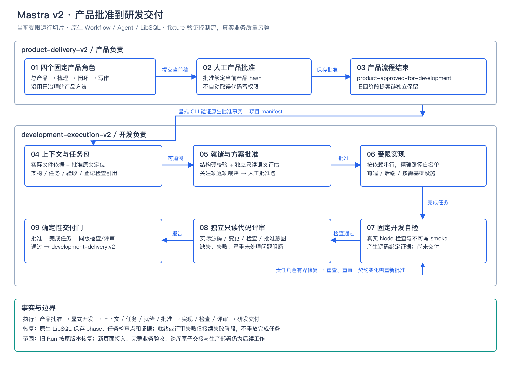

# BMAD 方法与 Mastra 工作流融合设计

**2026-11-07 演进**：Studio 已替换为一条[完整产研流程](./unified-workflow.md)，产品批准后在同一 Run 确认项目并继续动态团队开发。原生 `foreach` 按依赖波次并行，任务负责人通过受限 `delegateTask` 委派。下文双 Workflow、CLI 交接与串行实现是 11 月 6 日版本记录；旧入口不再注册到 Studio。新边界见[统一团队决策](../../docs/decisions/2026-11-07-mastra-unified-development-team.md)。本轮不运行测试。

2026-11-06，状态：**v2 已接入受限运行，真实质量收益待验**。用户明确要求修改运行流程后，已实现两个版本化 Workflow；原生离线回归与真实业务质量分开。选型与剩余边界见[融合决策](../../docs/decisions/2026-11-06-mastra-bmad-method-integration.md)。



[可编辑 SVG](../../docs/assets/mastra-bmad-workflow-v2.svg)

## 融合目标

形成“产品确认 → 开发准备与批准 → 实现、自检、评审和返工 → 研发交付”的业务闭环。Mastra 原生 Workflow、Agent、Store 和执行 Adapter 继续负责运行；BMAD 的方法、模板及检查维度用于补强上下文、任务交接和评审。

成功证据是实现前的阻塞遗漏减少、任务级验收可追溯、交付前能发现真实缺陷，且人工审阅、耗时和模型用量可接受。增加文档、角色数量或模型自报通过均不算收益。

## v1 基线与 v2 当前行为

| v1 旧基线 | v1 代码依据 | v2 当前行为 |
| --- | --- | --- |
| 产品四角色产出稿件，`review-product` 保存批准；旧链随后继续生成开发、测试、运维提案 | `src/mastra/workflows/product.ts`、`delivery.ts` | 执行模式在产品批准后结束产品流程，交接已批准版本；旧提案链单独保留 |
| `approvedDevelopmentInput` 从已保存产品批准派生开发输入 | `src/development-service.ts` | 继续校验来源事实，显式识别产品 Workflow 版本与交接目标 |
| 架构有方案级 `coverage`，任务字段为 `id/role/paths/dependsOn` | `src/development/contracts.ts` | 加入任务级验收引用、上下文、实现约束与已登记验证引用 |
| `approve-architecture` 批准后才实现；按任务顺序执行，文件范围受限 | `src/mastra/workflows/development.ts` | 就绪检查放在批准前；批准同时绑定方案、任务包和所用依据 |
| `development-self-check` 依据真实检查结果直接设置 `development-delivered` 并生成交付包 | 同上 | 自检通过只形成中间证据；只读评审及独立交付门通过后才生成 v2 交付包 |
| 故障接续依赖原生暂停、源码检查点与执行身份 | `src/development/recovery.ts`、`src/development-service.ts` | 新步骤沿用并扩展检查点语义，新增失败位置必须有单独回归 |

现有开发执行仍为受限实践；当前验证范围以[开发设计](./development-workflow-design.md)及[续办记录](./evaluations/development/continuation-2026-11-06.md)为准。

## 历史：一条业务路径，两个版本化 Workflow

当前 v2 路径如下，产品入口注册在共享应用，开发入口按独占目录装配：

```text
product-delivery-v2（新执行入口，复用既有四产品角色）
  原始需求和允许读取的资料
    → 四角色产品子流程
    → review-product：人工确认当前产品版本
    → product-approved-for-development：结束产品流程
        │
        └─ 服务/CLI 验证批准事实和项目 manifest，显式启动
             development-execution-v2
               initialize-development
                 → prepare-context：核实允许范围内的项目上下文
                 → architecture：技术方案和任务包
                 → assess-readiness：结构校验 + 只读语义检查
                 → approve-architecture：人工确认绑定版本
                 → implement：按依赖顺序执行任务
                 → development-self-check：真实工程检查
                 → review-code：独立只读评审
                 → assess-delivery：确定性交付门
                 → development-delivery.v2：研发交付包，结束
```

跨 Workflow 的交接以已保存批准事实为依据。首版继续显式启动开发，需要项目 manifest 和独立运行目录；不因产品批准自动取得仓库写权限。产品库与开发运行库保持当前各自归属，不增加统一审批数据库或 BMAD 状态文件。

旧 `product-delivery` 继续原有提案语义，新执行入口不调用旧下游 `draft-development/draft-testing/draft-operations`。旧链的“开发提案”不是开发执行结果。旧产品版本可经显式参数启动开发并记录来源 Workflow，不截断旧 Run；当前未提供跨入口消费排他或全局启动去重。

## 节点、职责和交付物

| 节点 | 执行者与权限 | 输入 | 输出与约束 |
| --- | --- | --- | --- |
| 产品子流程 | 既有四角色、既有只读资料范围 | 原始需求、来源材料、人工反馈 | 产品稿、验收和未决项；已有 PM 方法继续承担需求工作 |
| `prepare-context` | 只读上下文方法，由架构职责执行 | 批准产品、manifest、允许读取的项目文件 | `ProjectContext`，逐项记录文件依据与散列；只概括实际读到的规则 |
| `architecture` | 既有架构 Agent，增加任务交接方法 | 产品、上下文、现有源码 | 方案、接口和 `TaskPackage[]`；不写源码、不批准 |
| `assess-readiness` | 宿主结构校验 + 与作者分开的只读评估调用 | 产品、方案、任务包、证据引用 | `ReadinessReport`，区分确定性问题与语义发现 |
| `approve-architecture` | 人工、原生暂停恢复 | 方案、任务包、就绪报告和绑定 hash | 批准或拒绝；批准不扩张 manifest 权限 |
| `implement` | 前端、后端、按需基础设施实现角色 | 本任务包、必要上下文和相关失败证据 | 实际源码变更、工具证据；首版继续串行、精确文件责任 |
| `development-self-check` | 原自检角色与固定执行 Adapter | 当前源码、已登记检查 | `CheckEvidence`；结果与当前源码 hash 绑定，检查失败不进入交付 |
| `review-code` | 新增 reviewer 职责，只读，无写入/批准工具 | 产品、方案、任务包、diff、源码和检查证据 | `CodeReviewReport`；检查意图一致性、边界异常和验证缺口 |
| `assess-delivery` | 宿主代码 | 同版本批准、自检、评审和问题处理记录 | 交付、有界返工或暂停人工；不依赖自然语言“通过” |

新增节点不等于逐个新增常驻 Agent。上下文和任务包属于架构职责；就绪与代码评审复用一个只读评估工厂、分开调用和记录职责。reviewer 不承担独立测试阶段，也不设计或执行任意测试命令。

## 方法资产如何复用

已从 BMAD 6.12.0 官方发布包取出所选资产，逐一核对11份源文件与发布元数据 `gitHead` commit `05bfbd46d00766ec88eb9b42e76be2c575d64d7b` 的raw字节一致。四个方法目录保留MIT、选定参考与逐文件来源锁；其他原文跳转/脚本/配置/委派/状态/审批依赖明确不导入。宿主仅借鉴方法，并不执行上游完整工作流。

| 复用主题 | 本地 Skill 名称 | 适配要求 |
| --- | --- | --- |
| 项目上下文核实 | `development-bmad-context` | 核实规则来源，区分持久约束与需实时读取的源码事实 |
| 规格到任务交接 | `development-bmad-task-handoff` | 映射当前批准产品、任务责任与验证引用，不另生成冲突 PRD |
| 开发就绪评估 | `development-bmad-readiness` | 借鉴开发前就绪方法；输出建议，推进条件由代码决定 |
| 代码评审 | `development-bmad-code-review` | 保留问题证据和处理结论，移除自动改代码、运行任意命令或调度角色的要求 |

按当前根 AGENTS 规范，新增通用开发方法已位于根 `.agents/skills/development/<bmad-技能目录>/SKILL.md`，与根实现交接 Skill 共用治理；Mastra 实践的 `product-pm` 目录仍是已有用户指定产品套件的例外。已同步根 Skill 索引并运行治理脚本。

每项保留中文执行入口、上游原文/参考资源、许可和来源记录。只给需要的方法角色挂载对应 Skill；不把整套 BMAD 和已有全部 PM Skill 再挂给所有开发角色。BMAD 的宿主交互、状态文件、Shell、角色委派和批准动作映射到当前工具及 Workflow，未提供的能力明确为不可执行。

v2工厂已按职责最小挂载，实际 `skill`/`skill_read` 结果核对注册原文；未读取即捕获失败。v1工厂保持原行为。与 `product-pm-intended-vs-implemented`、`product-pm-code-review` 的正确性/意图对照存在交集，因此不同时加载完整产品套件；此次 BMAD 适配侧重任务规格、开工可实现性和逐发现处理证据，方法优劣仍待同条件对照。

## 数据契约与版本绑定

以下为已实现的 v2 契约，字段以 `src/development/v2/contracts.ts` 为准。

| 对象 | 核心字段及约束 | 所有者、可空与可变性 |
| --- | --- | --- |
| `requirements[]` | `id/line/text/hash`；按非空产品原文行生成 `product:L…` 定位索引，产品 hash 在 `input.source` | Workflow 派生保存；行定位不代表自动完成语义需求拆解 |
| `ProjectContext` | `productHash/baselineHash/methodBundleHash/files/rules/unknowns`；文件散列、规则引用和未决项 | Workflow 步骤输出不可变快照；准备前可空，准备后必须存在 |
| `TaskPackage` | `id/role/paths/dependsOn`，增加 `requirementRefs/acceptanceRefs/contextRefs/constraints/verificationRefs` | 架构输出，人工批准前可生成新版本；批准后不能原地编辑 |
| `ReadinessReport` | `assessment/sourceHash/planHash/checksHash/hash`；assessment 含 `verdict/findings/coverageRefs/unchecked/resolutions` | 宿主先校验结构与引用，再保存语义报告；缺失不等于 PASS；旧版进入 `readinessHistory` |
| `Finding` | 稳定 ID、类别、严重度、需求/任务引用、文件/证据定位、建议责任角色 | 评估者输出；处理结论另加 `resolution`，不删除原发现 |
| `CodeReviewReport` | 与就绪共用报告结构，绑定当前 `sourceHash/planHash/checksHash`；批准和方法 hash 保存于状态 | reviewer 只读生成；缺失、失败、引用覆盖不足不能解析为空报告 |
| `GateDecision` | `decision/reasons/sourceHash/reportHash`；决定交付、修复、重规划、澄清或停止 | 宿主计算；人工逐发现裁决保存于独立 `findingsReviews/resolutions`，不能修改真实检查结果 |
| 执行检查点 | `phase/checkpointHash/completedTasks/calls/faults/recovery/recoveries` | 原生 Workflow 持有；明确下一阶段、已完成任务、调用预算与故障接续证据 |
| `development-delivery.v2` | 产品/批准包/源码/检查/评审 hash、方法来源、变更范围、问题处理、限制 | 只由交付门生成；交付前必须为空；导出副本不是运行事实源 |

任务包中的 `verificationRefs` 只能引用宿主已登记检查；不得由模型注册 shell 字符串或修改 `checkFiles`。需新增检查或扩大可写范围时，返回方案及 manifest 审查，不以适配 BMAD 为由扩大执行权限。验收引用的存在可以确定性校验；语义完整性仍需要评审，不能用“每项都有 ID”代替质量证据。

架构批准绑定 `productHash + baselineHash + contextHash + planAndTasksHash + readinessHash + executionIdentity + methodBundleHash`。实际 hash 采用当前宿主规范化规则，审批和恢复共用同一构造，禁止每个入口自行拼接。

实现时源码自然变化，不要求一直等于初始 `baselineHash`；每轮检查和评审绑定当轮源码，交付要求最终源码与最后成功证据一致。需求、接口契约、任务范围或方法包改变时重新准备和批准；代码修复后原检查和评审失效，必须重新验证受影响范围。运行期间不热更新 Skill 或上游资源。

## 就绪与交付门规则

### 开发就绪

- 确定性检查负责来源批准、引用存在、任务依赖/文件责任、检查登记、hash 和权限一致性；任何失败阻止实现，人工不能通过评论绕过。
- 只读模型评估负责需求歧义、契约冲突、异常遗漏和验证缺口，逐项引用依据。模型建议为 `PASS/CONCERNS/FAIL`，不是授权指令。
- `PASS` 且结构合法后等待人工方案批准；`CONCERNS` 暂停，人工只能逐项引用证据判为 `not-an-issue`，保留旧报告并产生新报告后再批准，否则停止；`FAIL` 返回产品澄清或人工终态，无直接豁免。
- 业务规则缺失不能通过架构角色补猜；必须回到产品确认。原文已经明确的规则应引用原文，不重复作为阻塞提问。

### 研发交付

- 已批准产品和方案包仍有效，任务完成范围与批准一致。
- 登记检查全部有实际结果且成功，无超时、缺失或无法确认的结果。
- reviewer 成功返回可校验报告，覆盖声明及未查项可见，报告绑定当前源码和检查。
- 没有尚未处理的阻塞/严重问题；人工认定误报需要证据。真实越权、数据破坏、来源伪造或检查失败不提供“接受风险后通过”的旁路。
- 实际修复需重新检查和独立评审确认 `fixed`；人工只能引用证据判为 `not-an-issue`，或对低/中严重性代码关注项记录 `defer` 并在交付包披露，不能用人工评论代替修复。无法作出有效结论则 `manual-attention`。
- 宿主交付门通过才写 `development-delivered` 和 v2 交付包；自检和 reviewer 均不能提前写终态。

## 返工与故障恢复

| 原因 | 处理路径 | 版本与重新检查 |
| --- | --- | --- |
| 已批准业务规则缺失或变化 | 保留阻塞 Run，回产品产生新批准版本，再显式创建来源关联的新开发 Run | 旧批准不继承；重新准备上下文、方案、任务和就绪检查 |
| 架构或跨层契约问题 | 架构重规划任务及影响范围，重新就绪检查和人工批准 | 保留源码、已有调用/发现及门禁记录，替换当前计划并清理旧批准和任务完成标记 |
| 实现或覆盖缺陷 | 在当前批准文件范围内回责任实现角色 | 重跑相关已登记检查及评审；若需要新文件/新检查，先回方案审查 |
| reviewer 误报或无法确定 | 只读展示证据，暂停人工裁决 | 裁决绑定当前源码/发现 hash；不删除发现或伪造通过 |
| 模型超时/网络错误 | 沿用捕获、回滚、有限重试与原生恢复关口 | 检查点增加阶段及 `taskId`，失败就绪/评审调用不能重放已完成实现 |
| 结构输出错误、预算用尽或重复返工 | 暂停或终止，记录未完成项 | 无无限自循环；模型故障与业务返工分别记账 |

v2 已在 `route` 之外持久化明确的 `phase`（准备、就绪、实现、自检、评审、交付）和任务检查点，均由原生 Workflow 保存。明确路由的缺陷返工消耗 `maxReworks`，故障重试与人工接续沿用独立上限；重新规划不能重置整轮预算。预算在开始前登记，达到上限暂停或结束为预算耗尽。

## 兼容、入口与页面

- 旧 `product-delivery`、`development-execution`、嵌套步骤 ID 和 `development-delivery.v1` 保持原行为，历史快照不迁移为“已经 BMAD 评审”。
- v2 使用独立 Workflow ID、状态 schema 和交付版本，复用角色/工具/校验函数。旧产品入口及 v2 产品入口的已批准来源由 allowlist Resolver 读取真实快照，不接受客户端传正文代替批准。
- 新运行入口保存 Workflow ID/版本、Run ID 和模式，并与原生持久化输入核对。旧 `run.json` 没有版本时只路由旧流程；未知版本拒绝，不能自动按新流程恢复。文件只负责定位，原生 Store 保有权威状态。
- 当前页面继续使用旧提案服务；新执行模式使用专用 CLI/Workflow，产品批准后结束。页面模式展示和一键启动开发均为后续切片。
- 扩展状态投影/CLI 先显示任务、就绪发现、当前阶段和评审依据；真实账号/RBAC、跨库事务和跨实例启动幂等仍不属于本轮。
- 首版不承诺跨 Workflow exactly-once。中断后按已保存运行标识回读；若创建目录/Run 发生部分完成，展示不完整状态并要求核查，禁止静默另建目录重复执行。

## 分步实施与代码映射

| 顺序 | 具体变更位置 | 交付标准 |
| --- | --- | --- |
| 0. 固定方法来源 | 根 `.agents/skills/development/bmad-*`、根 Skill 索引；已有 `agents/skills.ts` 加载器 | 实际方法库存、依赖/许可/散列核验完成；原生工具能读，未知/越界资源拒绝 |
| 1. 版本化契约 | `src/development/v2/contracts.ts`，复用 v1 必要共享不变量 | 任务包、就绪、评审和证据 hash 可校验；v1 读写和恢复无回归 |
| 2. 准备与批准 | `src/mastra/workflows/development-v2.ts`、`src/development/v2/agents.ts`、`methods.ts` | 原生步骤完成上下文、任务、就绪及人工批准；未批准无法实现 |
| 3. 评审与交付 | `src/development/v2/gates.ts`、`invoke.ts` 及同一 v2 Workflow | 检查通过仍不能跳过评审；报告缺失、漂移、阻塞不交付 |
| 4. 产品交接 | `src/mastra/workflows/product-delivery-v2.ts`、`src/mastra/app.ts`、两个 v2 service、两个专用 CLI | 新入口复用产品子流程，批准后停止于交接；旧提案路径保持；来源和版本识别正确 |
| 5. 对照与体验 | `evaluations/development/`、必要的 CLI/状态投影，再单独建设页面 | 同一任务、模型、预算比较实际收益；全栈及独立测试另验 |

步骤 0–4 已在隔离原生回归闭环后接入新入口；步骤 5 的真实质量对照和页面仍待执行。离线结果保留来源/版本，不能用 v1 的通过计数替代新增方法效果。

## 验收计划与重评

- [x] 来源：固定 commit、实际方法/参考依赖、许可原文和散列；完成与现有 PM 方法的重复项比较。
- [x] 控制流：未批准、FAIL、未解决关注、检查失败、评审失败/缺失、源码漂移均不能交付。
- [x] 主路径：批准产品 → 上下文/任务/就绪 → 人工方案批准 → 实现 → 真实检查 → 只读评审 → v2 交付。
- [x] 返工：实现修复、架构变化、产品澄清和人工误报裁决分别回到正确节点，旧批准/证据正确失效。
- [x] 恢复：就绪/评审超时与结构错误、检查点漂移、重开进程和预算耗尽；失败 reviewer 不重复已完成实现。
- [x] 兼容：旧提案链、旧执行 Run、旧暂停点与 CLI 仍按旧版本读取/恢复；未知版本拒绝。
- [x] 工程：实践 `npm run check`、相关及完整回归、Skill 治理、OpenSpec strict 和差异/文档链接检查；新页面另跑前端构建。
- [ ] 效果：预登记同条件对照，独立人评遗漏、错误阻塞、评审误报、人工修改量、审阅秒数、耗时和 token；未评保留未评，不预设 BMAD 更优。

增加多角色调用可能提高耗时和用量，先比较最少方法集合。出现误报导致频繁阻塞、重复资料成本过高、上游重大变更或当前固定任务范围无法承载真实需求时，重评方法选择和接入粒度。完整 SaaS 研发、任意代码仓库、生产多实例、自动测试放行和生产部署不由本设计推导。

本轮已接入源码并完成隔离原生回归，决策接受工程适配；真实业务质量、人评和成本净收益另验。维护责任由 Mastra 实践维护者承担；退出时停止创建v2，保留证据，运行中v2不得降级v1绕过交付门。

## 上游依据

- [BMAD v6.12.0 README](https://github.com/bmad-code-org/BMAD-METHOD/blob/v6.12.0/README.md)：方法资产与现有规划/交付方式的组合入口。
- [BMAD v6.12.0 CHANGELOG](https://github.com/bmad-code-org/BMAD-METHOD/blob/v6.12.0/CHANGELOG.md)：规格/架构到构建交接、项目上下文、就绪与代码评审方法的演进线索；实际导入以固定 commit 的源文件为准。
- [BMAD v6.12.0 LICENSE](https://github.com/bmad-code-org/BMAD-METHOD/blob/v6.12.0/LICENSE)：已保留并核验原文；来源锁记录发布包和固定commit证据。

## 运行命令

在本实践根目录使用 Node.js 24+。模型模式和数据目录沿用原配置；以下只展示显式参数，不写入凭据。

```bash
# 新执行模式产品：四角色 → 人工产品批准 → 结束
npm run product:delivery -- start '业务需求'
npm run product:delivery -- status <productRunId>
npm run product:delivery -- review <productRunId> <productHash> approve <reviewer> '产品批准意见'

# 显式启动 v2：只从保存批准派生正文，manifest不提供任意命令
npm run development -- start --dir .data/development/<id> --product <productRunId> --manifest <project.json>
npm run development -- status --dir .data/development/<id>
npm run development -- review --dir .data/development/<id> --hash <approvalHash> --decision approve --reviewer <reviewer> --comment '确认就绪和技术方案'

# 捕获故障：原phase接续；不重做此前完成的实现
npm run development -- recover --dir .data/development/<id> --hash <recoveryHash> --decision retry --reviewer <reviewer> --comment '确认安全检查点'

# 发现裁决：读取当前suspendPayload.hash，逐项处理，错误请求不消耗暂停
npm run development -- resolve --dir .data/development/<id> --hash <findingsHash> --decision resolve --reviewer <reviewer> --comment '逐项核实' --resolutions <decisions.json>

# 新批准业务版本，使用新目录；原Run/批准/证据保留
npm run development -- clarify --from .data/development/<old> --dir .data/development/<new> --product <newApprovedProductRunId> --comment '产品补充依据'
```

`decisions.json` 是数组，每项含 `reportHash`、`findingId`、`decision`、`reason`、`refs`。人工可用 `not-an-issue`（引用反证）；代码评审低/中严重性可 `defer` 并在交付包披露，严重发现/就绪问题不得延期。人工不使用 `fixed` 跳过重新实现/检查，完整性问题没有裁决放行。`--decision stop --resolutions <空数组文件>` 可保存停止决定。示例：

```json
[{"reportHash":"<当前源报告SHA256>","findingId":"<发现ID>","decision":"not-an-issue","reason":"批准原文明确记录此规则，见行引用","refs":["product:L1"]}]
```

要读取旧产品批准，启动或澄清时显式加 `--product-workflow product-delivery`；旧提案链继续自己的下游，不被v2截断。新运行需显式旧版行为可用 `--workflow development-execution`。重开则由 `run.json.version` 定位，缺省只进v1，未知版本拒绝。文件不是批准真相，恢复前仍核对原生payload、输入、方法、模型与源码检查点。

`CONCERNS` 进入 `resolve-readiness` 原生暂停，逐项误报裁决产生新就绪报告并保留旧报告，再等待技术方案批准。`FAIL` 保留阻塞并结束为业务澄清或人工处理。实现缺陷走责任角色有界修复；跨层契约问题重新准备、就绪和批准。无归属/需人工判断的代码问题进入 `resolve-findings`；所有原发现保留，处理记录独立追加。未审维度在报告公开，固定检查或模型PASS不代表产品独立验收。

运行总模型调用不超过72次，单调用最多12步、6000输出token、总180秒/步骤90秒；模型瞬时故障至多调用2次，整Run人工故障接续至多1次，业务返工依输入 `maxReworks`（0–3）且重新规划不重置。尚未承诺强杀进程后的任意阶段恢复或跨实例运行。

## 当前验证

Node 24.22.1 下类型检查、完整实践122/122测试、Mastra构建和离线smoke通过；其中23项新增v2回归涵盖产品到开发交接、原生四方法读取、批准/漂移、失败报告、就绪裁决、严重问题延期拒绝、实现/架构返工、新批准产品澄清、就绪/评审重开接续和旧入口兼容。根 Skill 治理、OpenSpec strict（1/1）、图资产、文档链接与差异检查通过。另以独立 CLI 进程完成产品启动/批准、开发启动/批准和重开状态读取，验证实际保存的 v2 版本与交付包。未调用付费真实模型，未宣称 BMAD 相比原流程降低遗漏或成本；现有live批次和历史人评不计入v2收益。

页面仍接旧提案服务；新产品执行交接和开发管理通过CLI。没有修改既有账号/RBAC、全栈检查白名单、生产部署或两个数据库之间的原子交接边界。
